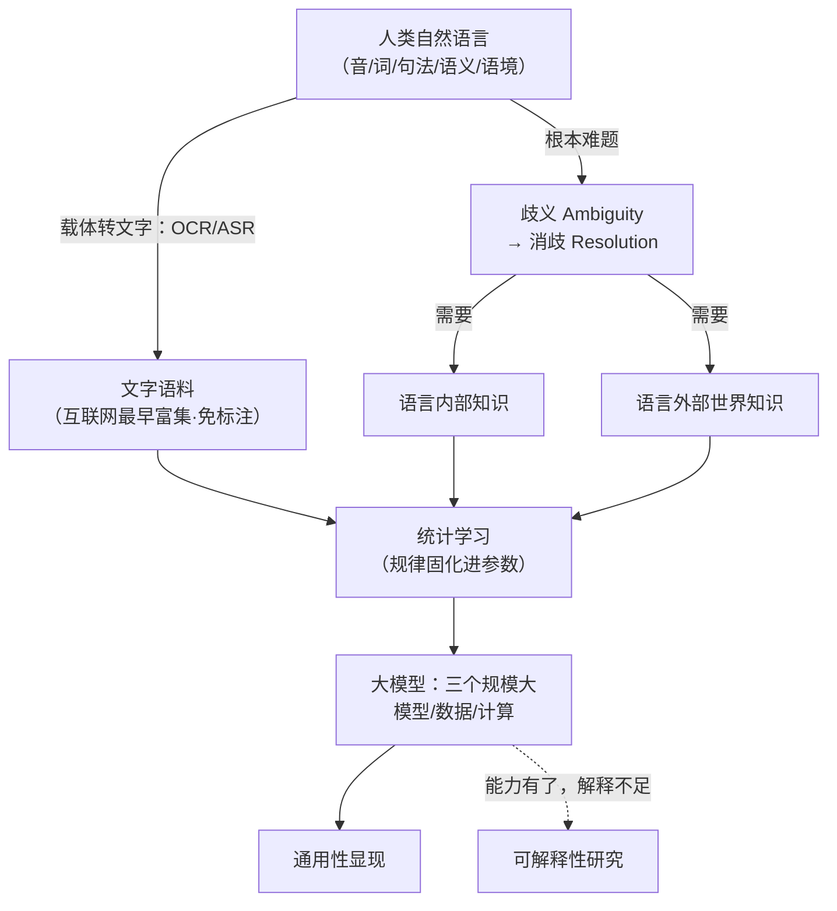

# 计算语言学基础 · 第 1 课 绪论 · 思路大纲

## 主线（讲者是怎么推下来的）

1. **人**：以 30 年 NLP 亲历（分词→文摘→检索→抽取→奥运多语言系统）立信——"冷门三十年等来爆发"
2. **立规矩**：教育平台操作、上课节奏（3+1）、考核构成（8×6+10+参与+40）、建群——把"怎么一起度过这 8 次课"先定下来
3. **给定义**：计算语言学 = 计算视角研究自然语言；自然语言 vs 人工语言；科学目标（解释语言）+ 工程目标（处理语言）
4. **理名字**：CL/NLP/NLU/HLT 之辨；ACL 的双义（学会 + CCF-A 年会）；技术工程超前科学认知的现状判断
5. **上例子（问题侧）**：语言的载体如何进计算机（OCR/ASR）→ 大模型为何从语言起步（语料富集+免标注）
6. **核心难题**：一路例证歧义——施氏食狮史（音→字）、分词三切分、词性/词义、"重要会议精神"（句法）、拆迁条款（现实代价）、语境（语义）→ 抽象出"消歧"这一根本问题
7. **转折（方法侧）**：两条路线——模拟人（借鉴 attention/CNN，但人的机制未揭示）vs 把语言当符号统计（主流）；规律固化进参数，概率输出换来可解释性之殇
8. **讲来历**：80 年简史——军事 MT（Weaver 密码破译）→ 1962 ACL/1966 ALPAC → 规则 vs 统计（乔姆斯基 vs Jelinek）→ 机器学习/深度学习接力 → 大模型三个"规模大"；两个根本变化：表示（2013-）与范式（2018-）
9. **中文的根**【PPT】：刘涌泉（中国第一篇 MT 论文）→ 刘倬（JFY）→ 董振东（科译 1 号/知网），老师留到下节细讲
10. **落课程与连接**：两阶段映射（串→表示→串）定全课纲；8 章阅读 + 报告 + 实践的考核；以 27 人行业画像收束——"这张网本身就是课程资源"

## 概念关系

## 如果只记三件事

- **消歧是 NLP 的根本问题**——语言内部知识 + 世界知识，两者最终都来自数据
- **大模型从语言起步有必然性**——文字语料最早富集且自监督免标注
- **技术超前科学**——工程能打 ≠ 理解了语言；可解释性是欠下的账
