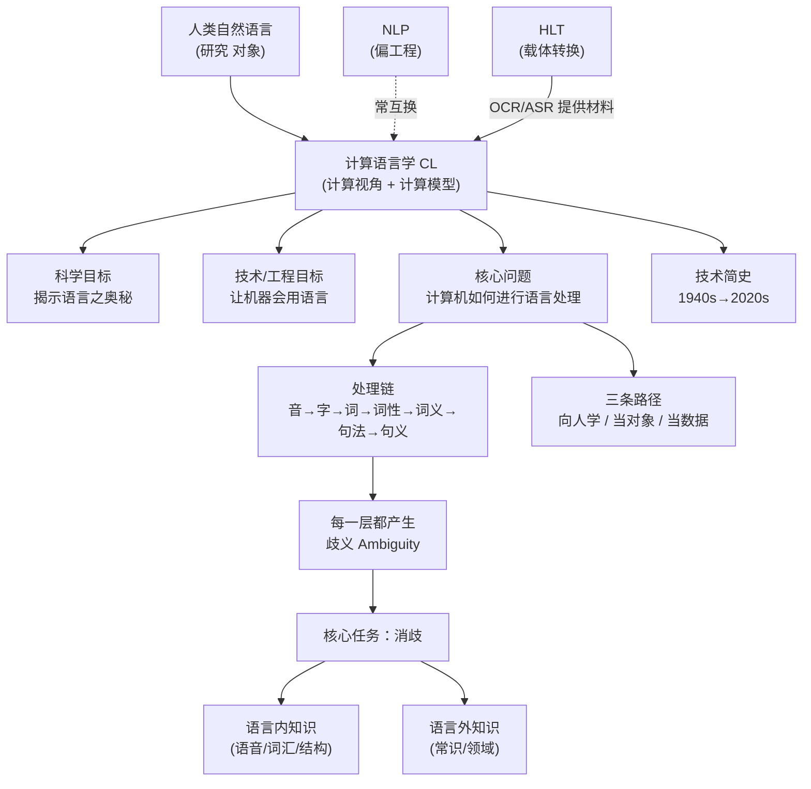

# 计算语言学基础 · 绪论 · 思路大纲

## 主线（老师是怎么推下来的）

1. **立规矩**：先讲课程怎么上、怎么算分（平台、8 次阅读、报告、实践、11/30 截止）
2. **给定义**：什么是 CL——计算视角 + 科学/工程双目标 + 计算与语言学的交叉
3. **理名字**：CL（偏科学）/ NLP（偏工程）/ HLT（管载体转换）三名一物
4. **提问题**：核心问题 = 计算机如何进行语言处理；三条借鉴路径（向人学 / 当对象 / 当数据）
5. **上例子**：拿一条处理链现场走一遍——`音 → 字 → 词 → 词性 → 词义 → 句法 → 句义`，**每一层都歧义**
6. **收结论**：于是 CL 的核心任务落在 **消歧（Ambiguity）**，难点是**语言内 + 语言外**两类知识如何表示与选用
7. **讲来历**：用 80 年技术简史说明"这条路不是突然出现的"
8. **落课程**：课程按"语言串 → 中间表示 → 输出串"组织；给出参考资源与评分
9. **数家底**：中国 CL 先驱（本讲仅列出，老师留到下节细讲）

## 概念关系

## 如果只记三件事

- **CL 是什么**：用**计算模型**研究自然语言——既解释语言（科学），也让机器会用语言（工程）。
- **核心难点**：语言在**每一层都歧义**，CL 的核心任务就是**消歧**，而消歧要**语言内 + 语言外**的知识。
- **课程骨架**：一切语言计算 = **语言串 → 中间表示 → 输出串**；考核 = 48 + 10 + 2 + 40，**11/30 24:00 截止**。
