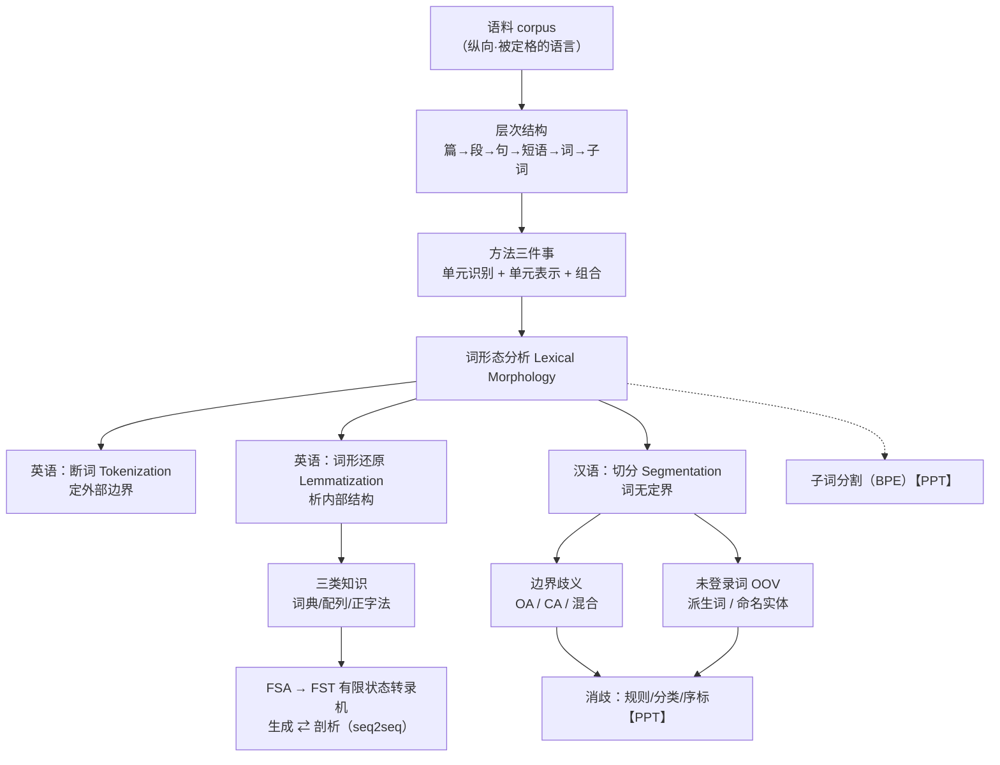

# 计算语言学基础 · 第 2 讲 词形态分析 · 思路大纲

## 主线（讲者是怎么推下来的）

1. **收尾过渡**：先补完绪论——研究史"涓涓细流"、2013 表示之变与 2018 范式之变、知识体系（本体/单元×语法语义语用）、公开评测之力、可解释性，以及中国先驱（留到下节）
2. **立框架**：第 2 章引言——语言分横向/纵向交流，**语料**承载纵向记忆；语料有**层次结构**（篇→段→句→短语→词→子词）；**理解自下往上汇聚、生成自上往下规划**；方法永远是"**单元识别 + 单元表示 + 组合**"三件事
3. **聚焦到"词"**：本章取"词"这一层单元 → 词形态分析（Lexical Morphology）
4. **英语·定边界**：断词 Tokenization 确定词的**外部边界**；英语靠空格标点近乎"平凡任务"，但缩写/混排等例外多 → 正则表达式（NLTK）
5. **英语·析内部**：词形还原 Lemmatization 还原词典原形（省词典、聚语义）；构词法 `前缀+词干+后缀`，穷举不可行 → 剖析（串→结构）/生成（结构→串）互为反向
6. **英语·建模**：涉及**三类知识**（词典/配列规则/正字法）→ 引入**中间层**双层结构 → 词典用 **FSA**、配列与正字法各用 **FST**；生成/剖析靠 FST 对称复用；后有用 **RNN 抽取 FST** 的研究，本质是 **seq2seq**
7. **汉语·定任务**：汉语是独立语，**词无定界** → 独有"**切分**"任务；赵元任/吕叔湘/王力/徐通锵的"字/词"之争，切分标准不唯一 → 用"切分单元"取代"词"
8. **汉语·找难点**：两大拦路虎——**边界歧义**（交集 OA / 组合 CA / 混合）与**未登录词 OOV**（派生词、命名实体）；歧义又分**真实**与**伪**歧义
9. **转折/延伸**【PPT】：面对这些难点，早期走**基于规则**（FMM/BMM）、**基于分类**、**基于序标**（HMM/CRF/深度）的路线；再往后是**子词分割**（BPE 等）；并用**最小编辑距离**做非词错误检测与纠正——这些转写未展开，见 corrections.md

## 概念关系

## 如果只记三件事

- **方法三件事**：单元识别 + 单元表示 + 组合——任何语言任务都这样拆
- **英语靠 FST，汉语靠消歧**：三层知识（词典/配列/正字法）用 FSA→FST 建模，生成与剖析是同一机器的两个方向；汉语没有"词"，难点全在边界歧义与 OOV
- **一切终归消歧**：切分、检索、输入法背后都是"在多种可能性里选一个"，与第 1 讲的歧义主线一脉相承
