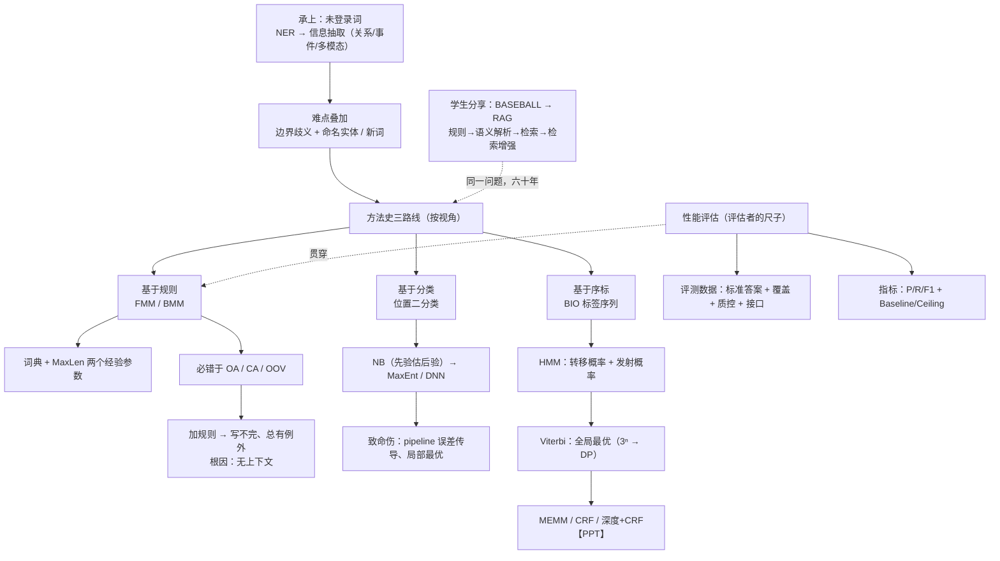

# 计算语言学基础 · 第 3 讲 汉语切分方法与评测 · 思路大纲

## 主线（讲者是怎么推下来的）

1. **开场·方法论**：老师先自陈"把前面的方法补足"——同学对早期方法陌生、对深度/大模型更熟，故本讲求纵深不求进度；读史两体会"二十年河东二十年河西""螺旋式上升"
2. **承上**：由第 2 讲的"未登录词"引出 **NER**（首次被单独提出）→ 更大的 **信息抽取**（关系/事件/多模态）→ 知识图谱；新词是持续监测对象
3. **立难点**：把两类麻烦叠起来——**边界歧义 + 命名实体**、**边界歧义 + 新词**（"敦煌市长孙熙龙说""赶超女举 58 公斤级"），复杂度陡增
4. **给史观**：同一段历史可有两种切法——**技术**（规则→机器学习→深度学习）与**视角**（规则→分类→序标）；本讲按视角讲，第一章（规则）是任何语言任务的共同起点
5. **规则·FMM**：**前向最大匹配**——词典 + 两个经验参数（**MaxLen**、**词典内容**）；"语言学很重要"逐步示例；MaxLen 权衡、专名入典难题
6. **插曲·评估（评估者视角）**：评测要有**带标准答案、覆盖够、说得清来源**的数据（标注标准→专家标注→交叉检验→委员会判定→迭代）；覆盖度/质控/接口；论文的"信服证据"
7. **评价指标**：例"本 报 讯 春节 临近"→ **P 以自己输出为分母、R 以标准答案为分母**、**F1 调和**；**邻接表**统一计算；**Baseline**（模型比较 vs 任务难易）与 **Ceiling**（离人还差多少；大模型已部分超人）
8. **规则·BMM 与失效**：**后向最大匹配**（倒着输入、先砍前头）→ FMM/BMM 必错于 **OA/CA/OOV** → **加规则**（"个人"前是数词）却遭遇"规则写不完、总有例外"（"中国第一个人网站"）→ 根因：**只用词表、没有上下文**
9. **视角之变·分类**：位置**二分类**（分/不分）→ NB（先验估后验、特征条件独立）→ 更细粒度特征 → **MaxEnt 极大熵**/DNN → 致命伤：**pipeline 误差传导、局部最优**
10. **视角之变·序标**：**BIO 标签**把切分变成序列标注 → **HMM**（观测=字，状态=B/I/O；转移+发射概率；"天气考古"冰淇淋例）→ **Viterbi** 求全局最优（3ⁿ → 动态规划）→ MLE/Baum-Welch → HMM 不足 →（PPT）MEMM/CRF/深度+CRF **转写未展开**
11. **学生分享**：从 **BASEBALL**（1961）到 **RAG**——结构化库+规则 → 语义解析 → 稀疏/稠密检索 → 检索增强生成，六十年始终在"表达能力 vs 可信可控"间权衡

## 概念关系

## 如果只记三件事

- **一条演进主线**：规则（无上下文）→ 分类（引入上下文，但 pipeline 局部最优）→ 序标（BIO + 全局决策）——问题是方法的推手
- **两把尺子定成败**：FMM/BMM 的 MaxLen 与词典决定切分质量；评测的"标准答案+覆盖+来源"决定结论是否可信
- **一切终归联合决策**：从逐位置二分类到 Viterbi 全局最优，本质是"在多种切分可能里选一个整体最优"，与第 2 讲的"消歧"主线一脉相承
