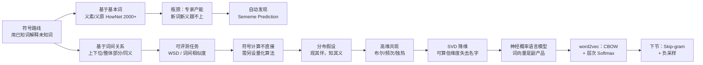

# 思路大纲 · 第 5 讲

## 主线

一句话：**符号（可解释、不可算）→ 数值（可算、不可解释）**，本讲就是把词义从"人写的定义"搬到"机器能算的向量"，而搬家的通行证是分布假设。

## 分段地图

| 段 | 转写行 | 讲了什么 | 课件 |
| --- | --- | --- | --- |
| 开场 | L1–L20 | 三条路线、词典释义、符号 vs 数值 | 03-1 P1–P11 |
| 义原 | L21–L59 | HowNet、义原发现流程、"打"的两个 DEF、刘群/李素建相似度 | 03-1 P12–P14 |
| 专家 vs 自动 + 心理学 | L60–L168 | 词典追查、专家法缺点、Sememe Prediction、特征表说、义素约束搭配、方法论插话 | 03-1 P15–P19 |
| 词间关系 | L169–L220 | 上下位（IS-A）、全体—成员、整体—部分、为何易落地 | 03-1 P21–P25 |
| 关系的毛边 | L221–L294 | 同音/同形/异音、动物园 22 个动词、反义四类、多义 vs 同形 | 03-1 P26–P32 |
| WSD 与相似度 | L295–L370 | Lexical Sample / All-words、SENSEVAL→SemEval、相似≠相关、词林/WordNet/FrameNet | 03-1 P33–P46 |
| 符号法的问题 | L371–L383 | 选哪些关系、粒度主观、不可直接计算 | 03-1 P48 |
| 分布假设 | L384–L470 | Firth、布尔/频次、维度=词表大小、独热、优缺点 | 03-2 P3–P7 |
| SVD 降维 | L471–L511 | 特征选择 vs 抽取、LSI、特征值 6.1/3/2.1/1、可解释性代价 | 03-2 P8–P11 |
| 神经概率语言模型 | L512–L547 | Bengio 2003 四层、词向量是副产品、softmax 复杂度 | 03-2 P13–P16 |
| CBOW + 层次 Softmax | L548–L658 | word2vec 两模型两训练、词袋、哈夫曼 95=40+55、课程事务 | 03-2 P17–P34 |

## 三条支线（不是主线，但值得记住）

1. **砖头问题**：任何"用有限解释无限"的方案都要回答"基本单元是什么、多少算够"。义素卡在人的产能，词向量绕开了这个问题但换来不可解释。
2. **可解释的代价**：符号关系是人能读的（上下位、反义），但不能直接算；向量能算，但"第 37 维是什么"没人答得出。两种代价互为镜像。
3. **降维的两种走法**：SVD 是"先统计再压缩"（数学完备、算得贵），神经网络是"边预测边学"（算得快、要大数据）。层次 softmax 是把 O(V) 归一化压成 O(log V) 的工程补丁。

## 如果只记三件事

1. HowNet 的 2000 多个义原 + "打毛衣/打酱油"两个 DEF，是"词义可分解"最具体的证据。
2. 相似 ≠ 相关：医生与急症相关但不相似——这是词向量之后做义项定位时最容易踩的坑。
3. 哈夫曼树按词频建、高频词路径短：层次 softmax 的全部成本优势都来自这一句。
