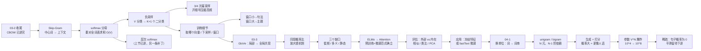

# 思路大纲 · 第 6 讲

## 主线

一句话：**先把"怎么把词变成向量"算完（Skip-Gram + 负采样），再把"这个词向量到底靠不靠得住"拆开看（GloVe／缺口／评估／应用），最后把单位从词放大到词串，撞上稀疏这堵墙。**

## 分段地图

| 段 | 转写行 | 讲了什么 | 课件 |
| --- | --- | --- | --- |
| Skip-Gram | L150–L184 | 与 CBOW 方向相反、多正例、softmax 分母代价 | 03-2 P35–P51 |
| 负采样 | L185–L320 | 二分类化、一正配 K 负、K 的取法、sigmoid+交叉熵 | 03-2 P51–P58 |
| 采样分布 | L296–L360 | 词频 + 3/4 次幂、开根号类比、采样池之争 | 03-2 P55 |
| 训练细节 | L361–L395 | 两套向量怎么取、下采样、窗口与 Levy 2014 | 03-2 P59–P60 |
| 第三章小结 | L396–L455 | 方法谱系回顾、转向 03-3 | 03-2 P62–P65 |
| GloVe | L460–L520 | 局部 vs 全局、ice/steam 比值表、log 双线性（略推导） | 03-3 P3–P11 |
| 三个缺口 | L521–L565 | 低频词、多义（LDA/多原型）、ELMo 与静态/动态 | 03-3 P12–P16 |
| 评估 | L570–L640 | 外部任务、词相似、词类比、PCA 可视化、维度无定论 | 03-3 P19–P24 |
| 应用 | L641–L700 | 任务面、冻结/微调、fastText、机器文本检测 | 03-3 P26–P35 |
| 第三章收尾 | L700–L745 | 多模态、上下位词、高斯分布两个 open question | 03-3 P38–P42 |
| N-gram | L745–L796 | unigram、bigram、N 元、生成与打分 | 04-1 P1–P13 |
| 稀疏 | L797–L820 | 莎士比亚实验、参数 10^4→10^8、概率为 0 | 04-1 P14–P18 |

## 三条支线

1. **所有近似都在省同一笔账**：层次 softmax 把 O(V) 归一化压成 O(log V)，负采样干脆把 V 分类拆成二分类。两条路解决的是同一个分母，选哪条是工程口味。
2. **窗口是唯一的隐式语义开关**：不改模型、不改目标函数，只改窗口大小，学到的就从「句法可替换」变成「主题相关」。这是词向量最便宜也最容易被忽略的超参。
3. **N-gram 的失败不是精度问题，是覆盖问题**：参数按 V^N 涨，语料按线性涨，中间那条缝就是数据稀疏。平滑不是优化技巧，是承认「没见过的组合也该有概率」。

## 如果只记三件事

1. 负采样把「词表里哪个词是邻居」这个 V 分类问题，变成「这一个词是不是邻居」的二分类，一个正例配 K 个负例，K 小数据取 5~20、大数据取 2~5。
2. GloVe 的贡献不是新模型，是换了一个统计量：从「同现概率」换成「同现概率比」，比值天然把「两者都相关」的干扰词压到 ≈1，相关信号被放大。
3. 词向量的历史遗产是范式而非某个模型：预训练学表示、下游微调，这条线从词向量一路走到 ELMo、BERT，本讲把它的起点讲完了。
