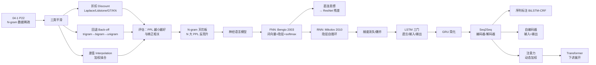

# 思路大纲 · 第 7 讲

## 主线

一句话：**N-gram 撞上天花板 → 平滑救不了 → 神经网络来 → RNN 有时序 → 梯度出问题 → LSTM 加门 → Seq2Seq 统一任务 → 注意力解决瓶颈——每一步都是前一步的"天花板"逼出来的。**

## 分段地图

| 段 | 转写行号 | PPT 页 | 主题 | 关键动作 |
|---|---|---|---|---|
| seg1 L1-100 | 04-1 P22-P41 | 平滑技术 | Laplace/Lidstone/Good-Turing/KN | 推导加1对高频/低频的影响 |
| seg1 L101-184 | 04-1 P42-P51 | 评估 | PPL、熵、分支因子 | N-gram 天花板 |
| seg2 L1-100 | 04-2 P1-P20 | NNLM | Bengio 2003 结构 | 词向量+隐层+softmax |
| seg2 L101-200 | 04-2 P21-P39 | 实验+RNN | Brown/AP 语料对比、RNN 结构 | FNN→RNN 的动机 |
| seg2 L201-295 | 04-2 P40-P58 | 自回归+LSTM | 梯度消失、BPTT、门控 | 三门机制详解 |
| seg3 L1-100 | 04-2 P59-P81 | GRU+双向 | 双向 RNN、多层、探针 | 序列标注铺垫 |
| seg3 L101-200 | 04-2 P82-P99 | Seq2Seq | 编码器-解码器、BiLSTM-CRF、自编码器 | 统一 NLP 任务 |
| seg3 L201-313 | 04-2 P100-P110 | 注意力开头 | 打分函数、软对齐、可视化 | 下讲预告 |

## 与前后讲的关系

- **上接第 6 讲**：N-gram 从"数据稀疏"停住，本讲从"平滑"续上
- **下接第 8 讲**：注意力详细展开 → Transformer → 预训练语言模型
