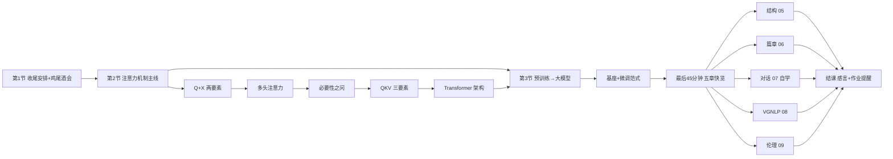
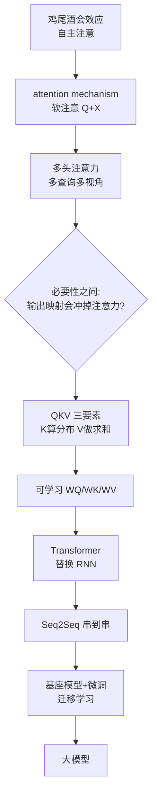

# 大纲 · 第 8 课（最后一课）

## 主线 10 步

1. 收尾安排：老师收束"值得讲的思想"，其余放自学；作业 11.30 截止、实践占 40 分。
2. 认知科学引入：鸡尾酒会效应（自主注意）+ 处理容量有限（蜜蜂忘路 → LSTM 遗忘门同源）。
3. 两种注意：自上而下（目标驱动）vs 自下而上（刺激驱动）；借鉴到模型 = attention mechanism。
4. 软注意实现：Q+X 两要素——相似度打分 → softmax → 加权求和；查询重塑词向量。
5. 多头注意力：查询天然多个 → 多视角投影拼接；引出"注意力会不会被输出映射冲掉"的必要性之问。
6. QKV 三要素：X 拆成 K（算分布）+ V（做求和）→ 保原始信息；WQ/WK/WV 引入可学习参数。
7. Transformer：注意力替换 RNN（并行 + 跨距离）；编码块/解码块/mask 因果遮蔽/FFN 存知识/位置编码；不可能三角。
8. 预训练范式：Seq2Seq 是通用模型的"小窗户"→ 基座+微调 → 迁移学习；BERT/GPT/T5 三分流；T5 任务前缀 = 指令微调雏形。
9. 五章快览（最后 45 分钟）：结构（句法树/依存图/乔姆斯基层级）→ 篇章（衔接 vs 连贯/指代共指/Winograd/RST/LDA）→ 人机对话（自学）→ VGNLP（跨模态）→ 伦理（敬畏）。
10. 结课：主动学习/跟踪前沿/动手应用三诉求；第二届结课感言。

## Mermaid 课时流程

## 概念依赖链（本课核心）

