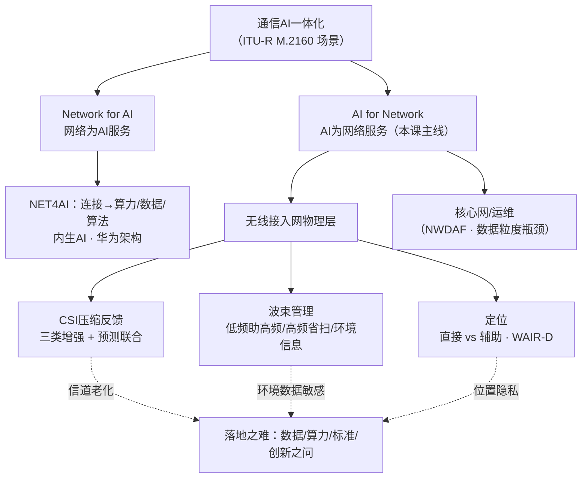

# 移动通信技术前沿 · 第1讲（课程介绍 + 智能空口技术）· 思路大纲

## 主线（讲者是怎么推下来的）

1. **问题**：5G→6G 演进中，无线信道"变且不知怎么变"的根本难题在大规模 MIMO/高频段下被放大到传统方法失效，而 AI 与无线正在深度融合（90% 硕博论文与 AI 相关）——智能空口（AI for air interface）是什么、进展到哪、难在哪里？
2. **铺垫**：课程框架与考核（8 次课、20/40/40）；行业演进线（5G-A 增强→太赫兹/语义通信/RIS/通感一体/天地一体）；ITU-R M.2160 六大场景中的"通信AI一体化"，拆成 Network for AI 与 AI for Network 两个 for。
3. **核心论证**（AI for Network 空口侧三大用例，同构地"加模块→换环节→端到端替代"）：
   - **CSI 压缩反馈**：维度爆炸→传统四招（压缩感知/稀疏化/SVD/码本）有本质损失→三类 AI 增强（隐式单端细化/隐式双端/显式双端）→训练方式（单侧/双侧/全共享）→信道老化→反馈+预测三框架；
   - **波束管理**：高频衰减↑→波束赋形补偿（追光灯）→宽窄波束矛盾→3GPP TR 38.843 P1/P2/P3 流程→三大类论文地图（低频助高频/高频省扫/环境信息）；
   - **定位**：新场景分米级需求→传统 PRS/TDOA 不足→直接定位 vs 辅助定位→数据隐私瓶颈→WAIR-D 数据集；
   - **课题组示范**：智能天线优化（数字孪生+RL 破 8^12 组合爆炸+潮汐效应）、流量预测（公开数据集+AI 业务建模无标准）。
4. **结论**：无线与 AI 深度融合是未来几年的确定趋势，标准（TR 37.817/38.843、M.2160）、数据平台（信通院/WAIR-D/ViWi）、竞赛三线并进；空口三大用例都有从"可对比"到"端到端"的清晰技术路线。
5. **转折/延伸**：算法之外全是坑——数据（隐私/自我循环）、算力（时延吃掉收益）、业务模型（AI 流量无定论）、创新界定（换算法算不算创新）；"2030 年 6G 部署没几年了，拭目以待"。

## 概念关系

## 如果只记三件事

- **两个 for**：Network for AI 是让网络原生长出 AI 服务能力；AI for Network 是让 AI 接管空口物理层——本课只讲后者，三大用例 CSI 反馈/波束管理/定位。
- **同构演进**：三个用例都沿"在现有流程里加 AI 模块（即插即用、可与传统对比）→双端替换环节（5G-A 引入）→端到端显式重构（6G、学术主流）"三级爬升。
- **真正的瓶颈不是算法**：实测数据没有、位置与流量数据涉隐私、终端算力把复杂度变成时延、AI 业务流量模型尚无标准——博士选题的护城河在场景与闭环，不在换网络结构。
