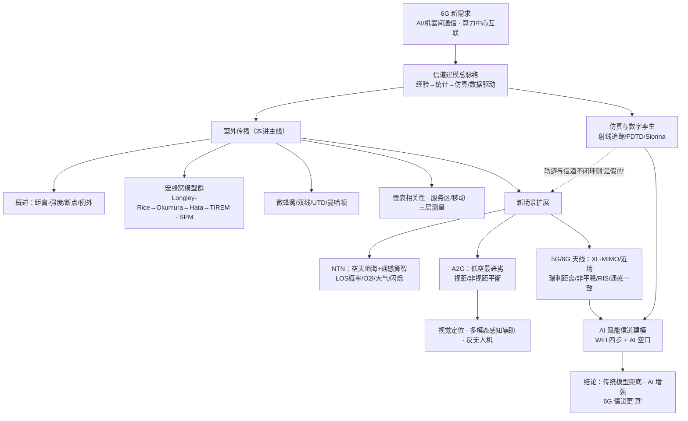

# 移动通信技术前沿 · 第2讲（电波传播与信道建模）· 思路大纲

## 主线（讲者是怎么推下来的）

1. **问题**：6G 的需求可能不再来自"用户升级手机"，而来自 AI/机器间通信与算力中心互联——光/无线/铜线的边界在变模糊；在这种背景下，信道模型该怎么做、做到什么精度、AI 到底能帮多少？老师先把标尺立在方法论上：**难的是找到问题，不是解决问题**，并强调传统模型是 AI 时代的"兜底"。
2. **铺垫（建模总脉络）**：经验模型（快、给均值）→ 统计模型（给分布）→ 仿真/数据驱动（与环境一一对应）；三者是"精度 vs 效率"的连续谱，走到第三阶段是因为算力够了、且感知/3D/雷达需要精确环境。
3. **核心（室外传播）**：
   - 概述：距离-强度看斜率，断点（城区 1km / 郊区 100m），"越远越弱"有波导/干涉等**例外**；
   - 宏蜂窝模型群（Longley-Rice → Okumura → Hata/COST-231 → Walfisch-Bertoni/COST 231-WI → LEE/Egli/Carey/Bertoni-Xia/TIREM）+ SPM 的"地球剖面逐层算"；
   - 微蜂窝/双线/多线/准三维 UTD/宽带 PCS——能算强弱但缺角度与宽带；
   - 混合室内-室外（曼哈顿模型）；
   - 慢衰相关性（Markov/时间-空间相关：不能每台手机各生成一套，要按地图）与服务区/移动模型；测量分大/中/小三个尺度。
4. **演进（仿真与数字孪生）**：射线追踪/射线发射/FDTD 精度高但代价大；NVIDIA Sionna 类数字孪生既能生成数据又能评估，但**若轨迹与信道不闭环、不与真实网络交互，"这个仿真就是假的"**。
5. **扩展（新场景）**：NTN（空天地海 + 通感算智；视距概率、基本路损=自由空间+杂波+阴影、O2I 穿透、大气损耗与"无线电窗口"、电离层/对流层闪烁，强调"辩证看频点"）→ A2G/无人机（**低空城市最恶劣**；视距/非视距是平衡；参考信号按高度分配、可移动天线、视觉定位、多模态感知辅助通信与反无人机）。
6. **前沿（5G/6G 天线）**：massive → XL-MIMO、频率上到毫米波/太赫兹；近场/远场以瑞利距离划分（球面波 vs 平面波）；空间相关性、非平稳性（按单元建模）、GSCM（散射体按形状）、RIS、通感一致性——**让空间颗粒度更细、参数按位置给定而非随机**。
7. **结论（AI 赋能信道建模）**：以张建华「WEI + AI 空口」四步（感知→特征→语义→知识）把黑盒变知识库，实现场景自适应/实时推理/预测式；老师自己的"图像信道"用 3–4dB 精度换 2–3 个数量级算力；场景适应性（环境天天在变）最难，传统 CSI 仍作兜底。

## 概念关系

## 如果只记三件事

- **一条建模脉络**：经验（快、均值）→ 统计（分布）→ 仿真/数据驱动（与环境一一对应），核心是"精度 vs 效率"的平衡，三阶段并存而非替代。
- **两个反复出现的判据**：**问题比方法重要**（找到问题才是护城河）、**传统模型兜底**（数据驱动在垂直领域数据不全、易出错，CSI 不能丢，AI 是增强）。
- **6G 信道更"真"**：XL-MIMO/近场/RIS/通感一致性要求散射体按形状、参数按位置/环境给定（而非随机统计），这正是射线追踪与数字孪生的用武之地；而场景天天在变，**环境理解与泛化**是 AI 信道建模最难的关。
