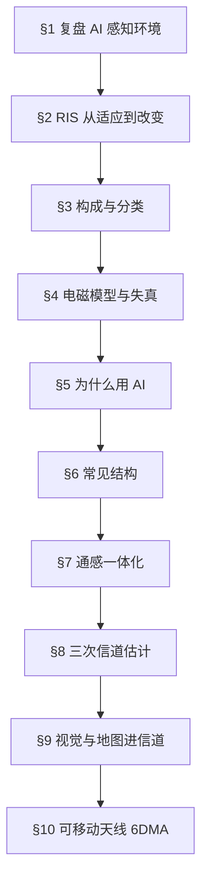

# 第 3 讲 结构图

## 主线

猜信道（§1）→ 改信道中间（§2–§8）→ 改链路两端（§9–§10）。

## 分块

**第一块 猜信道（§1）**
- 环境信息省掉波束扫描与反馈，25% 开销（属上一篇论文）。
- 四步范式：感知 → 特征 → 任务语义 → 电磁计算。
- 三个未解：兜底基准、校准、虚实结合与生命周期。

**第二块 改中间（§2–§8）**
- RIS 的立身理由：信道可控比信道可测值钱。
- 智能 = 感知 + 决策 + 执行闭环，否则只是超表面。
- 失真四来源：理论近似、硬件量化、单元独立假设、环境简化。
- 结构按控制维度演进：相位 → 极化 → 互联拓扑。
- ISAC 瓶颈：通信与感知共用一个可控信道。
- RIS 的真实成本：换一次配置就要重测一次信道；毫米波才划算。

**第三块 改两端（§9–§10）**
- 视觉与地图替代部分信道测量，天花板是感知精度。
- 6DMA：三位置 + 三旋转，天线位置从常量变变量。
- 挑战：非凸、CSI 更缺、运动需调度；unfolding 保可解释。

## 记忆钩子

- RIS 的账：板子便宜、选址贵、信道难测。
- MA 的账：自由度多、信道变得更快。
- 一句收束：自由度越多，要重新知道的信道越多。
