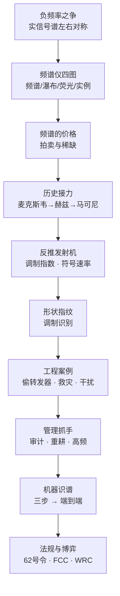

# 第 4 讲 · 思路大纲

## 主线

1. **先破一个直觉**：有没有负频率？→ 实信号功率谱左右对称，频谱仪从 0 Hz 起扫就够。
2. **再建一个工具**：一台频谱仪的四张图（频谱图 / 瀑布图 / 荧光谱图 / 实例图），横轴纵轴与单位。
3. **问一个价格**：频谱为什么贵？→ 有限、不可再生、国家战略资源；欧洲 3G 约 1000 亿欧元，美国 5G 约 800 亿美元。
4. **补一段史**：麦克斯韦（理论）→ 赫兹（实验，误判不能通信）→ 马可尼（跨大西洋）；傅里叶的论文被泰勒驳回。
5. **学一种读法**：从曲线反推发射机 → 谱线高度差给调制指数，谱宽给符号速率，B = Rs(1+α)。
6. **练一种眼力**：形状即指纹 → 2FSK 双峰、AM 带大载波、QPSK 平顶；一个符号速率胜过一堆特征。
7. **看一层暗面**：频谱之上还有密码战 → 明码与字典码皆不可靠，豪密靠"一次一密 + 收发分离"。
8. **进工程现场**：偷转发器、鑫诺卫星、CP16 救灾、机场干扰、Starlink 信标。
9. **谈管理抓手**：审计 RB 利用率、频率重耕、6G 三条提效路径（尤其"往高频走 = 找没人争的地方"）。
10. **交给机器**：模式识别三步 → 端到端深度学习；MATLAB 分类器 APP 演示。
11. **落到法规与博弈**：62 号令、频谱模板、车载雷达 4 GHz 带宽账、FCC 12.2–12.7 GHz 论战、WRC-23/27 与手机直连。

## 结构图

## 三条线索的递进

- **物理层线索**：功率谱密度是唯一被反复使用的量，从定义（维纳–辛钦）到测量（RBW 积分）到应用（I/N、EPFD）都是它。
- **工程线索**：所有工程案例都指向同一件事——**把看不见的占用变成可举证的图**。
- **制度线索**：频率先被切分（划分表、频谱模板），再被定价（拍卖/占用费），最后被写进条约（ITU RR、WRC 决议）。

## 只记三件事

1. 谱线高度差 → 调制指数；谱宽 → 符号速率；B = Rs(1+α)。
2. 提效三条路：审计重耕、先进技术、往高频走；高频的真正好处是没人争。
3. 6 GHz 与低轨是 WRC-27（2027 上海）的两大议题。

## 记忆钩子

- **"半边天"**：实信号看右半边就够。
- **"高度差是深度，宽度是速度"**：ΔdB 给 m，B 给 Rs。
- **"八车道 vs 一车道"**：太赫兹双向八车道，10 兆一车道。
