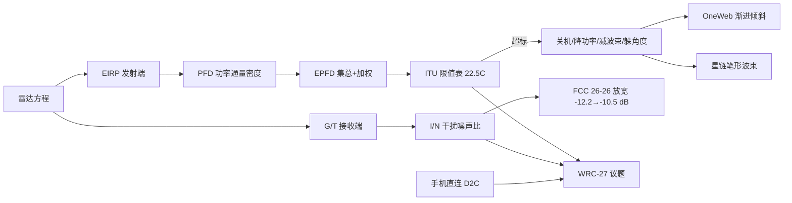

# 大纲 · 第 5 讲 EPFD 与低轨卫星频率共存

## 主线 10 步

1. 一口真锅开场：三种电视 → 卫星锅工作原理 → Ku 波段 LNB 指标。
2. 冲突起点：10.7–12.75 GHz 同时是卫星电视与星链/OneWeb/O3b 的频段，高轨优先。
3. 雷达方程课堂推导：PR 公式、4π³ 的来历、主任的 2000 块悬赏。
4. 发收两端指标：EIRP 与 G/T；无源天线只有方向性增益；手机 G/T≈0~−20 dB。
5. 指标链收口：PT→EIRP→PFD→EPFD；EPFD = Σ 集总 + 接收增益加权（RR 22.5C）。
6. 限值表与换算：−166 dBW/m²/40kHz ≈ 每赫兹低于热噪声底；N=kTB 推 −174 dBm/Hz。
7. 杀伤力实例：星网卫星离美 2000 km 关机；先到先得、纸面卫星与里程碑计划。
8. 合规手段：降功率/减波束/躲角度；OneWeb 渐进倾斜专利；星链笔形波束不关机。
9. 规则战：WRC-23 未采纳 → FCC 26-26 放宽（I/N −12.2→−10.5 dB、协调/论证替代路径）→ WRC-27 议题（6G 划分 + 手机直连）。
10. 动手环节：月亮回波 Excel 链路预算（−261 dB 路损 / −197 dBW 接收）；D2D 四大挑战与 AST 228 m² 天线。

## Mermaid 概念图

## 只记三件事

1. **EPFD 的两个 E**：所有可见卫星求和（集总）+ 按 GSO 地面站接收增益加权。
2. **限值有多狠**：折算每赫兹比宇宙热噪声还低 → 中国星离美 2000 km 关机。
3. **规则正在松**：FCC 26-26 把 I/N 从 −12.2 放宽到 −10.5 dB，WRC-27 是下一回合。
