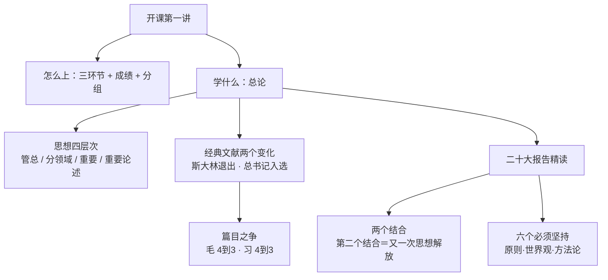

# 习近平著作选读 · 第 1 讲（导论 · 开课第一讲）· 思路大纲

## 主线（讲者是怎么推下来的）

1. **认人（立信）**：先做自我介绍——北邮马院教师、北大马院博士、写过《走进太平天国》与北大校史；以蔡元培的故事说明"讲这段历史要讲得不一样"。
2. **立课（定规矩）**：说明这是《习近平著作选读》的全国试点课、专题教学（一导论 + 两专题），固定三环节——阅读经典 → 老师授课 → 分组研讨。
3. **定考核与分组**：一排一组、轮流领读发言；平时成绩 30 分（考勤 + 研讨发言）；建微信群发题目。
4. **定框架（思想四层次）**：管总的指导思想 / 分领域思想 / 重要思想 / 重要论述——先给"读什么"的坐标。
5. **选文本（读哪些·选谁）**：经典文献两个变化（斯大林退出、总书记著作入选）与篇目之争（毛、习各 4→3 篇）。
6. **精读示范（总论）**：二十大报告的大会主题表述、伟大建党精神与红船、两个结合（第二个结合是又一次思想解放）、六个必须坚持。
7. **研讨与延伸**：三个题目自由发言（中国式现代化等）；同学结合工作发言；学员老师补讲"青年担当"三点。

## 概念关系

## 如果只记三件事

- **三环节**：先读（本排练读）→ 再讲（老师）→ 后研讨（分组）。
- **四层次**：管总的指导思想 / 分领域思想 / 重要思想 / 重要论述。
- **两个抓手**：两个结合（第二个结合是又一次思想解放）＋ 六个必须坚持。
