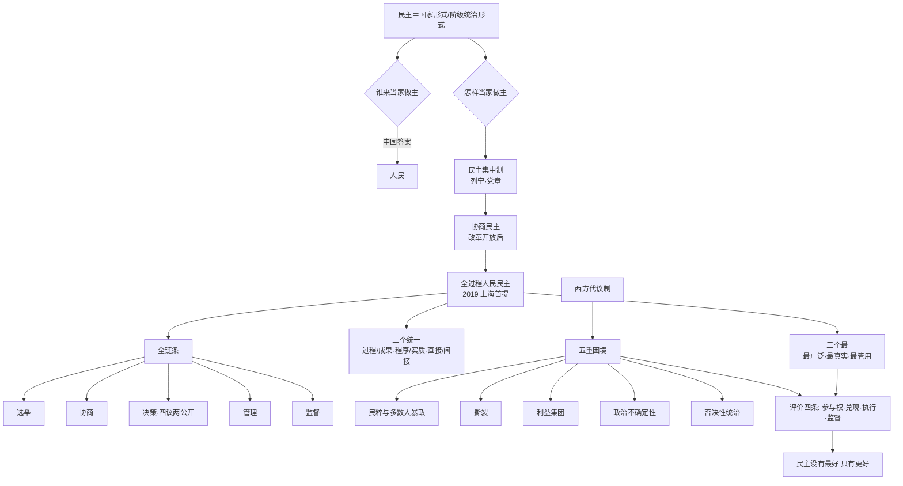

# 第 3 讲 · 思路大纲（专题五 · 全过程人民民主）

## 主线（10 步）

1. **同学先讲**（四段发言）→ 暴露"以选举比高低"的思维惯性。
2. **老师纠正两处**："一党专政"→"一党长期执政"；中国也有真实选举。
3. **金句定调**：民主选举不是民主政治建设的全部，一选了之肯定要出乱子。
4. **历史起点**：1945 年延安豆选（文盲 + 战争条件下的可行民主）＋ 潘龄皋题字（三朝老人看"能说话"）。
5. **概念清理**：民主＝国家形式／阶级统治的形式；古希腊（奴隶主）→ 近代（资产阶级）→ 社会主义（多数人）。
6. **两问一体**：谁来当家（人民）＋ 怎样当家（民主集中制 → 协商民主 → 全过程人民民主）。
7. **五环展开**：选举（制度设计决定结果）→ 协商（商量着办）→ 决策（四议两公开）→ 管理（自治）→ 监督（党内 + 党外）。
8. **对照反思**：西方五重困境（民粹／撕裂／利益集团／短视／否决政治）。
9. **评价标准**：四条"更要看" + 满意度数据 + "民主不是盆景"。
10. **收束**：三个"最"（最广泛／最真实／最管用）＋ 苏联教训 ＋ 国际关系民主化 ＋"民主没有最好，只有更好"。

> **按主题归并而非按时间切**：四节课连讲（课时 1 研讨、课时 2 概念与路径、课时 3 优势与困境、课时 4 制度细节与外部比较），同一主题在两节课里反复出现（如西方困境在课时 2/3、协商在课时 2/3/4），故按论证顺序重组。

## 概念关系（Mermaid）

## 只记三件事

1. **一条链**：选举→协商→决策→管理→监督，缺一环就退化成"一选了之"。
2. **一条线**：民主集中制—协商民主—全过程人民民主（2019 首提、2021 入决议、二十大定本质属性）。
3. **一句话**：民主是手段不是目的，四条"更要看"就是检验它有没有兑现的尺子。
