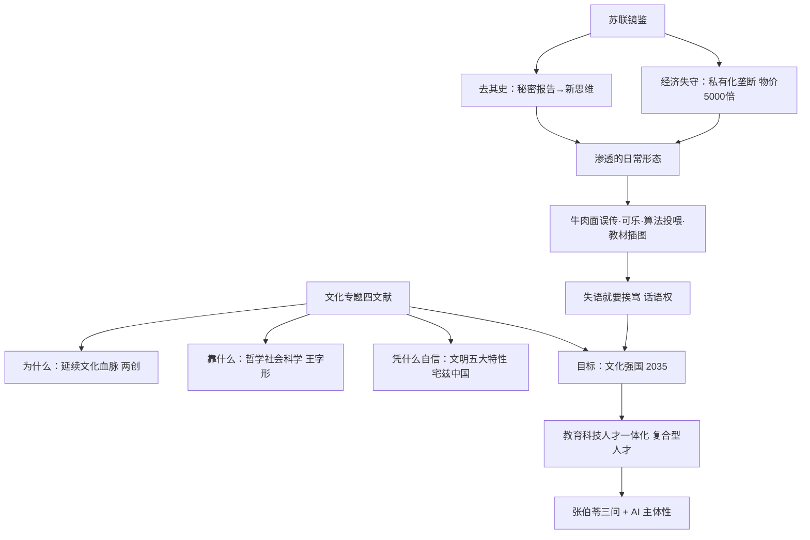

# 大纲 · 第 4 讲（文化专题）

## 主线 10 步

1. 开场：本专题四篇文献（两创出处 / 哲社座谈会 / 文明五大特性 / 文化强国）——为什么与靠什么、目标。
2. 破题一问：《大国崛起》12 集为何没有中国——崛起 vs 复兴（《复兴之路》）。
3. 哲学社会科学之重：德国重教育与思想家的启示；"赶路时精神要跟上"。
4. 马克思主义三大组成的"王字形"结构：哲学打底（一般规律）→ 政经解剖（商品/剩余价值）→ 科社立目标。
5. 最难研究的是人类思维；"解释世界"更要"改造世界"（北邮沙河校门语录）。
6. 老师亲历佐证：文科选择与能力用进废退；考博读《资本论》；学风与"板凳十年冷"。
7. 苏联镜鉴（上）：政权瓦解从思想领域开始——1956 秘密报告自我否定历史 → 戈尔巴乔夫新思维 → 1991 旗帜落地；渐进改革 vs 休克疗法。
8. 苏联镜鉴（下）：新自由主义药方（私有化+垄断）→ 物价飞涨 5000 多倍（老师口径）；普京"最大地缘政治灾难"；1998 年美国文化产品成第一大出口。
9. 渗透的日常形态：加州牛肉面的误传、可乐与判别年龄、算法投喂与信息茧房、品牌广告与教材插图丑化；三位同学讨论（有选择的真相 / 新闻私有化 / 台湾教材）。
10. 建设与落点：文化强国 2035；挨打→挨饿→挨骂；五大特性与"宅兹中国"；教育科技人才一体化、复合型人才；张伯苓三问；"比机器更弱，弱AI就是强控制"。

## Mermaid 概念图

## 只记三件事

1. **苏联不是亡于 1991，是亡于 1956**——自我否定历史的思想失守在前，制度崩溃在后。
2. **挨打→挨饿→挨骂**：话语权是这个时代的主权，2035 建成文化强国。
3. **比机器更弱，弱 AI 就是强控制**——能力用进废退，文化主体性与 AI 主体性同题。
