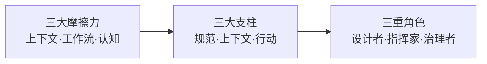
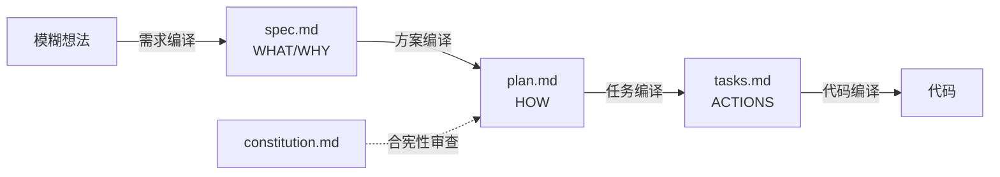

# AI原生开发工作流实战 — 学习指南

> 一句话价值总结：这门课教你用"规范驱动开发（SDD）"把 AI 从"写代码的助理"升级为"能理解意图、自主编排工作流、被安全约束的同事"——核心是转变认知：**规范才是真理之源，代码只是渲染产物**。

## 课程画像
- 讲师：Tony Bai
- 适合人群：有编程基础、正在或准备用 Claude Code/Cursor 等 Coding Agent 提效的工程师；希望把团队 AI 协作"工程化"的技术负责人
- 不适合人群：想学"某几个 Prompt 技巧"的速成者（这是方法论课）；对命令行工具陌生的纯前端新手
- 投入时间：推荐 6-8 小时（快览 1 小时 / 深度 4 小时 / 完整 8 小时）
- 价值密度：⭐⭐⭐☆ (3.2/5) — 概念篇与实战篇 TDD 是精华，中间大量工具操作会随版本贬值

## 阅读路线

### 路线 A：快速浏览（60 分钟）
- [02] 规范驱动开发 — 理由：全书第一性原理，"权力反转"与"编译意图"两个隐喻是理解一切的钥匙
- [19] AI驱动的TDD — 理由：两条黄金法则（防"自洽幻觉"、意图单一来源）是全课最深刻的洞察
- [13] Agent Skills — 理由："渐进式披露"是理解能力封装体系的核心
- [速递2] Skill 高阶心法 — 理由：4 条心法直接提升写 Prompt/Skill 的水平

### 路线 B：深度阅读（4 小时）
在路线 A 基础上补充：
- [07] constitution.md — 理由："宪法 vs 手册"的三维差异是约束 AI 架构决策的关键
- [06] CLAUDE.md/AGENTS.md — 理由：上下文工程核心，分层加载与 AGENTS.md 趋势
- [16] 顶层设计 — 理由：框架全景图是整合所有能力的可操作地图
- [20] 协同与审查 — 理由："确定性 vs 自主性"辨析解释了工具选择原则
- [答疑] — 理由："损耗左移""约束型 vs 信息型上下文"补齐了正文遗留的落地困惑

### 路线 C：时间充裕（8 小时）
全部 ⭐⭐⭐ 和 ⭐⭐ 章节，尤其补上：[01] 范式演进、[17][18] spec/plan/tasks 演练、[09][10] 安全基石、[11][12] Hooks/MCP、[14] Subagent、[15] Headless、[22] 维护重构

## 核心知识地图（按主题重组，非原课程顺序）

### 主题一：范式与角色 —— 你为什么不再是"码农"
**一句话总结**：AI 时代工程师的价值栈从"编码为主"倒转为"定义规范、编排工作流、治理质量"，这是所有技能背后的认知前提。

**关键框架**：三大摩擦力（上下文/工作流/认知）定义了问题；三大支柱（可执行规范/持久化上下文/可编排行动）定义了方案；三重角色转变（规范设计者/工作流指挥家/质量治理者）定义了你的新身份。

**可操作方法**：
1. 用 L1-L4 成熟度模型给自己定位，明确目标是"精通 L3、触及 L4"（来源：01 讲）
2. 从"手工复制粘贴上下文"切换到"让规范自动驱动 AI"（来源：开篇词）

**金句**：
> "我们正在从'与机器对话'的工匠，进化为'设计人机协作系统'的工程师。" — 第01讲

### 主题二：规范驱动开发 —— 代码不再是真理
**一句话总结**：SDD 是全书引擎，核心是"权力反转"——规范取代代码成为唯一真理之源，AI 扮演把意图逐级"编译"为代码的编译器。

**关键框架**：SDD 四阶段（意图定义 spec.md → 技术规划 plan.md → 任务分解 tasks.md → 自动化实现），配合"合宪性审查"门禁确保 AI 不跑偏。

**可操作方法**：
1. 需求阶段"做减法"，明确拒绝非 MVP 需求（PR diff、图片下载、重试机制）（来源：17 讲）
2. 计划阶段强制"合宪性审查"：让 plan.md 含 Constitution Check 门禁章节（来源：18 讲）
3. Bug 归属二分法：意图偏差改 spec.md 重新生成，实现错误直接修代码（来源：19 讲）
4. 多人团队用 CI 卡点"没 spec 不让合并"+ 定期让 AI 反向同步 spec（来源：答疑）

**金句**：
> "维护软件的核心，从'修改代码'，变成了'演进规范'。" — 第02讲
> "SDD 是用'思考的成本'置换了'返工的成本'。" — 精彩答疑

### 主题三：上下文工程 —— 给 AI 建记忆宫殿
**一句话总结**：用分层、持久化的上下文解决"AI 失忆症"，核心是区分"约束型上下文"（宪法，管合规）与"信息型上下文"（代码，管正确）。

**关键框架**：四级分层加载（企业→项目→用户→模块）+ 递归向上/动态向下发现；宪法（constitution.md）> 手册（CLAUDE.md）> 跨 Agent 标准（AGENTS.md）。

**可操作方法**：
1. 通用规范写进 AGENTS.md，Claude 专属能力写进 CLAUDE.md，通过 `@` 导入打通（来源：06 讲）
2. 用"抽象层级/强制力/可变性"三维度判断一条规则该进宪法还是手册（来源：07 讲）
3. 团队隐性知识"翻译"成无歧义指令（如"用户 ID 必须用加密 UUID"）（来源：06 讲思考题）

**金句**：
> "一份精心编写的上下文文件，本质上是你团队工程文化的'代码化'沉淀。" — 第06讲

### 主题四：能力封装与扩展 —— 编程你的 AI
**一句话总结**：把 AI 从"听话的执行者"变成"博学的思考者"，需要一套能力封装矩阵：Command（确定性流程）、Skill（自主发现）、Subagent（独立上下文专家）、MCP（连接外部系统）。

**关键框架**：渐进式披露三层模型（发现层只注入 description 索引 → 触发层即时加载 SKILL.md → 执行层按需加载脚本/文档），让 AI 知识库无限扩展而上下文保持轻量。

**可操作方法**：
1. 标准流程用 Slash Command（追求确定性），探索任务用 Skill（追求自主性）（来源：20 讲）
2. 写 Skill 放弃 MUST/NEVER 恐吓式写法，解释 Why；把确定性逻辑剥离给脚本（来源：速递2）
3. 给 Skill 写 Eval 测试：断言"是否调用了脚本"而非"AI 代码能否跑通"（来源：速递2）
4. Subagent 用"最小权限"只授只读工具，用链式编排组"虚拟项目组"（来源：14 讲）

**金句**：
> "从'命令'到'声明'的转变，就是'智能涌现'的关键。" — 第13讲

### 主题五：安全与信任 —— 让 AI 在镣铐里跳舞
**一句话总结**：对 AI 的信任必须建立在"即便犯错也无法造成破坏"的技术保障上——事前用权限+沙箱约束，事后用 Checkpointing 补救。

**关键框架**：权限体系防"已知的未知"，沙箱防"未知的未知"；Checkpointing 是会话级"影子 Git 快照"，提供 /rewind 三种回退。

**可操作方法**：
1. 权限规则 deny > allow > ask，Bash 用前缀匹配（注意可被 curl -L 绕过）（来源：09 讲）
2. "安全 YOLO 模式"：严格沙箱 + bypassPermissions 实现无人值守（来源：09 讲）
3. /rewind 三模式按需选：改错代码用"只回退代码"，说错指令用"只回退对话"（来源：10 讲）
4. 记住边界：Checkpointing 不跟踪 Bash 命令副作用（rm/git push 不可逆）（来源：10 讲）

**金句**：
> "安全不是效率的敌人，而是效率可持续的保障。" — 第09讲

### 主题六：自动化与交付 —— 从对话到 CI/CD
**一句话总结**：用 Headless 模式把 AI 变成"可编程函数"，串起根因诊断、CI 审查、文档同步的自动化闭环。

**关键框架**：`f(输入)=输出` 的函数化模型；`--output-format json` 提供可审计的执行日志；能力"沉淀与复用"闭环。

**可操作方法**：
1. 用 `-p` + stdin 管道 + `--output-format json` + jq 把 AI 变成 Shell 工具链的智能过滤器（来源：15 讲）
2. 根因分析 Prompt 构造：角色（验尸官）+ 四步任务 + @源码注入 + Markdown 输出（来源：22 讲）
3. 生成 Dockerfile/Makefile 后，封装成 /build、/docker-build 指令沉淀回框架（来源：21 讲）
4. 用 update-docs 指令让 AI 反向"编译"代码为 README，解决文档腐烂（来源：22 讲）

**金句**：
> "你的想象力，将成为 AI 能力边界的唯一限制。" — 第15讲

## 可忽略内容
以下章节信噪比 < 2.0，可直接跳过：
- [结课测试] 满分之约 — 理由：纯测试题入口
- [结束语] 人机共生新纪元 — 理由：展望+鸡汤，"领先业界 90% 开发者"属营销性夸大，无实质内容

以下章节信噪比 2.0-3.0，可只读小结：
- [04] 环境搭建 — 理由：纯环境配置，随版本快速贬值，仅"车身与引擎分离""五级分层配置"两个概念值得记
- [21] 构建与交付 — 理由：大段 Dockerfile/Makefile 源码走读，核心思想仅"能力沉淀回框架"一点

## 延伸阅读
- 相关书籍：《Software Engineering at Google》（工程文化）、Robert C. Martin《Clean Code》（TDD 与设计）
- 相关开源项目：[github/spec-kit](https://github.com/github/spec-kit)（SDD 参考实现）、[anthropics/skills](https://github.com/anthropics/skills)（官方 Skill 与 skill-creator）
- 相关协议/标准：[agentskills.io](https://agentskills.io)（Agent Skills 标准）、AGENTS.md（跨 Agent 上下文标准）、[MCP](https://modelcontextprotocol.io)（模型上下文协议）
- 相关参考：[Anthropic C 编译器实验](https://www.anthropic.com/engineering/building-c-compiler)（多 Agent 协同极限）
