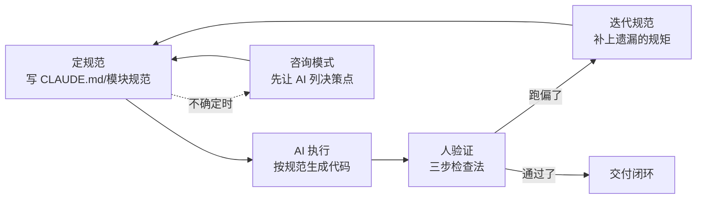

# Claude Code 企业级全链路开发实战 · 学习指南

> 一门"用 AI 工具做工程"的方法论课：载体是 Claude Code 从零造简版 Dify（Hify），真正的交付物是一套可复用的工程方法论。核心命题——**瓶颈不在 AI，在你**。

## 课程画像

- 讲师：Robert（一线大厂基础设施，10 年+ 经验）
- 适合人群：会用 AI 编程工具但提效有限的开发者；想系统性掌握"AI 原生开发"方法论的工程师；希望把 AI 工具从"补全"升级为"协作"的人
- 不适合人群：只想学 Claude Code 具体指令/快捷键的工具操作者；对 Spring Boot/Vue 技术栈完全不熟的人；已深度实践过 Spec-Driven Development 的老手（方法论大部分不新鲜）
- 投入时间：快速浏览 30 分钟（5 节金矿）；深度阅读 2 小时（金矿+银矿）；时间充裕 5 小时（全部）
- 价值密度：⭐⭐⭐（课程整体信噪比 2.98/5，但 5 节金矿讲达 4.0+，是真正值得精读的部分）

## 阅读路线

### 路线 A：快速浏览（30 分钟）
只需读以下 5 节金矿课：
- [02] 规范驱动开发（SDD）— 全课方法论根基，四步闭环
- [14] 把经验变成 Skill — 领域四问 + 经验沉淀
- [27] AI 写代码保证质量靠体系 — 论证最扎实，质量四层次 + 双模型 review
- [31] SDD/Spec-Kit/Spec Coding/老项目改造 — 工具谱系 + 改造三原则
- [32] 局限与起点 — 认知深度外化，能力地图收束

### 路线 B：深度阅读（2 小时）
在读路线 A 基础上，补充银矿课中的方法论高密度讲：
- [01] 你是架构师 — 角色转变的认知原点
- [03] 产品定义 — 三问裁剪法、五步法
- [15] Agent 创建与配置 — "现学现卖"能力
- [20] RAG（上）— 四步探路法
- [21] RAG（下）— 增量开发三步走
- [23] 工作流编排（下）— 技术调研驱动选型、分步实现

### 路线 C：时间充裕（5 小时）
读全部 gold + silver（22 节），跳过 5 节实操演示课和 08-12 工程脚手架。

## 核心知识地图（按主题重组，非原课程顺序）

### 主题一：认知与角色——你是架构师，不是打字员
**一句话总结**：AI 编程的价值上限由你的判断力决定，先完成"从执行者到架构师"的角色转变，AI 才能真正提效。

**关键框架**：
- 三层分工：架构师定方向 → AI 做实现 → 人做验证
- 认知深度外化：你写出的规范/提示词直接暴露你的认知深度，这是不可替代的竞争力

**可操作方法**：
1. 拿到需求先想清楚边界再动手，别直接让 AI 开写（来源：第 01 讲）
2. 每天做最多的事从"写代码"切换为"拆解问题"（来源：开篇词）

**金句**：
> "AI 是放大器，不是发动机。你有方向它放大十倍，你没方向它放大的是零。" — 开篇词/第 32 讲

### 主题二：SDD 规范驱动开发——让 AI 永远在轨道上
**一句话总结**：把开发流程改成"先写规范 → AI 执行 → 人验证 → 迭代规范"的四步闭环，规范是活的。

**关键框架**：
- SDD 四步闭环 + 咨询模式（不确定先问再做）+ 好规范的验收标准
- CLAUDE.md 五层结构：项目上下文 → 架构规范 → 代码组织 → 部署/数据库 → 接口+行为指令

**可操作方法**：
1. 把"模糊大需求"改写成"带验收标准的模块规范"，一次做对（来源：第 02 讲）
2. 用五层结构写 CLAUDE.md，每条规范都要能追溯到一个架构决策（来源：第 06 讲）
3. 用业界规范（阿里 Java 手册等）喂 AI 生成适配版，而非从零手写（来源：第 06 讲）
4. 对存量老项目按"从小到大、由快到慢"三原则逐步引入 SDD（来源：第 31 讲）

**金句**：
> "规范是活的，每次 AI 跑偏，问自己是不是规范没覆盖到，然后补上。" — 第 02 讲

### 主题三：陌生领域快速上手——现学现卖 + 四步探路法
**一句话总结**：不必在每个领域都熬三五年，用"领域四问"和"四步探路法"就能快速进入并落地一个陌生技术或业务。

**关键框架**：
- 领域快速理解四问：是什么 / 怎么用 / 数据怎么存 / 边界在哪
- 四步探路法：业务痛点 → 拆解技术组件 → 约束驱动选型 → 最小 Demo 建立手感
- 现学现卖闭环：让 AI 教概念 → 映射成数据结构 → 用具体场景验证 → 拆解执行

**可操作方法**：
1. 接到不懂的业务，先让 AI 用领域四问教你，再设计数据模型（来源：第 14/15 讲）
2. 学陌生技术时先让 AI 做业界调研，基于调研结果决策，而非凭感觉拍方案（来源：第 20/23 讲）

### 主题四：增量开发与质量体系——加新不破坏旧，质量靠体系
**一句话总结**：在跑通的系统里加新能力用"增量开发三步走"；AI 写代码的质量靠分层体系而非运气。

**关键框架**：
- 增量开发三步走：圈定改动范围 → 验证旧功能没坏 → 验证新功能生效（顺序不能反）
- 质量体系四层次：测试 → 静态检查 → 双模型 review → 人工把关
- 双模型 review：让第二个模型交叉审查主模型产出

**可操作方法**：
1. 给存量系统加功能时，指令里显式写"只改哪个方法、不改 Controller 层"锁死扩散边界（来源：第 21 讲）
2. 给 AI 代码接入双模型 review 工序，把质量从"靠人盯"变成"靠体系"（来源：第 27 讲）
3. 复杂功能分步实现（先线性→加分支→加错误处理→接入），review 精力放在异常分支（来源：第 23 讲）

**金句**：
> "保证质量的不是 AI，是体系。" — 第 27 讲

### 主题五：工程落地细节——产品定义、架构、数据、部署
**一句话总结**：真正的工程判断藏在细节里——边界取舍、瓶颈预判、数据库规范、SSE 的坑、可观测性。

**关键框架**：
- 三问裁剪法：没有它产品还成立吗 / 做到什么程度够用 / 能不能一句话说清
- 性能瓶颈软肋地图：让 AI 列出瓶颈、触发条件、处理时机，出问题查表
- 增量开发的第五次复用：SSE 三个坑（超时/客户端断开/Nginx 缓冲）、事务不跨 SseEmitter

**可操作方法**：
1. 动代码前用三问裁剪法砍掉伪需求（来源：第 03 讲）
2. 数据库规范写进 CLAUDE.md（逻辑删除进索引、游标分页、HNSW 索引）（来源：第 05 讲）
3. 部署前用咨询模式让 AI 帮你发现遗漏（如健康检查接口）（来源：第 28 讲）
4. 告警分级 P0/P1/P2 + "不建议告警清单"，避免告警疲劳（来源：第 29 讲）

## 可忽略内容

以下章节可以直接跳过（信噪比 < 2.5，纯演示/脚手架/收尾）：
- [07/12/19/26/30] 五节实操演示课 — 与对应正课内容高度重复
- [08/09/10/11] 工程搭建篇 — 脚手架铺垫，价值在"基础设施复用"而非本讲本身
- [17/18] 对话引擎下 / 复杂前端交互 — 实操为主，独立洞见少
- [开篇词/热点速递×2/结束语/结课测试] 附属内容 — 定位、评论、收尾、测试

## 延伸阅读

- **书籍**：《Building a Second Brain》（Tiago Forte，本技能方法论源头）、《如何阅读一本书》（Mortimer Adler）
- **工具/规范**：GitHub Spec Kit、阿里巴巴 Java 开发手册、Google Java Style Guide、OpenAI 官方 Function Calling 文档
- **技术**：MCP（Model Context Protocol）官方规范、pgvector 的 HNSW 索引文档
- **知乎选题**：见 `theme_articles/` 目录下的三篇主题深挖素材（SDD 方法论全景 / 角色重构 / 陌生技术探路法）
