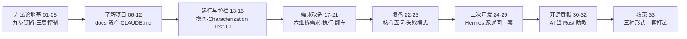

# 《Claude Code 企业级老项目改造实战》一页纸 digest

## 1. 这门课讲什么

一门讲"如何用 Claude Code 改造跑了多年的老项目"的实战课（讲师 Robert，37 讲）。核心立场：老项目改造的本质是"理解 + 开发"，AI 只改变分工不改变链路；**AI 是加速，不是兜底**。

## 2. 值不值得读

**总评 2.82/5（🥇5 🥈10 🥉17 ⛏️5），金矿占比 13.5%，方法论与水份约 4:6——值，但只值精读 15 讲。**

- **适合**：正用 AI 编码工具改公司老项目的中级工程师；想建立"AI 产出验证体系"的团队。
- **不适合**：AI 编程新手（先学基本操作）；期待"AI 全自动托管改造"的人（本课立场恰恰相反：人是最后的兜底员）。
- **差异化价值是"诚实"**：20 讲主动展示"和 AI 合作四讲才发现功能本来就有"的翻车全过程，22 讲给出失败模式自检——主流课程几乎见不到。

## 3. 精华讲清单（金矿地图）

| 讲 | 讲题 | 一句话结论 | 为什么值得 |
|----|------|-----------|-----------|
| 15 | 用 Characterization Test 锁住行为 | 断言凭"实际是什么"写，不凭"应该是什么" | AI 补测试会用业务直觉写"应该"断言，把历史包袱当 bug——应用级洞察，有 Feathers 经典出处 |
| 17 | 让 AI 帮你拆需求 | 需求六维 + AI 能力地图：AI 做 AI 强的，人守判断层 | 把"AI 当调研员"精确到维度：接口契约/edge case 归 AI，产品决策/范围归人 |
| 20 | 执行改造（下） | **先点产品确认"功能不存在"，再让 AI 开工** | 全课最可迁移的 30 秒兜底动作；罕见的翻车诚实复盘 |
| 22 | 核心五问 | **工作量下来 ≠ 思考量下来** | 省下的体力不投回判断，就是更快地走错路；三个失败模式自检清单 |
| 25 | 两次翻译拆技术方案 | 先出与技术栈无关的设计，再落方案；反问不是追问 | 设计→方案因果链可追溯；"别又冒新决策，把这版收紧"是高级提示词技巧 |

## 4. 核心概念依赖图

三层控制（理解→约束→验证）是全课骨架（03 讲）：**理解层**（docs 五份资产 + CLAUDE.md + SKILL，06-12）是 **验证层**（摸底 → Characterization Test → CI，13-16）的前提；两层就位后，**需求六维**（17）才能在改造中落地；20 讲的翻车揭示"现状确认"必须内嵌进流程，22 讲把它收拢为失败模式清单；25 讲的"两次翻译"是同一骨架在二次开发场景的复用。

## 5. 金句与方法论

1. AI 是加速，不是兜底——你省下的时间必须投回判断。
2. 20% 的盲区，经常就是 100% 的事故。
3. 断言凭"实际是什么"写，不凭"应该是什么"写。
4. 老项目改造的目标不是 80% 覆盖率，是改造路径上的关键节点都有兜底。
5. 工作量下来 ≠ 思考量下来。
6. 流程跑完效果差，99% 是该停的地方没停。（绝对化表述，讲师经验）
7. AI 扫代码再细，也不能替你点几下产品。
8. 反问不是追问：你有预期基准，才指得出 AI 漏了什么。
9. CLAUDE.md 只放"索引 + 常识"，禁区与历史包袱两节必须自己写。
10. 改造前花 70% 时间理解项目是正常且必要的。

## 6. 略读清单（铜/铁级）

| 讲 | 一句话 | 为什么可略 |
|----|--------|-----------|
| 02 | AI 进来后哪步变哪步没变；80/50/20 三档分工 | 经验数字无实证，观点已并入 03 |
| 04 | AI 编程工具全景罗列 | 名词堆砌、易过时 |
| 05 | 业界全景 + 三个债框架 | 框架有用（见卡片），但 6+ 条数据无出处，只取观点 |
| 07/08 | 摸底与文档技巧 | 常规工程实践复述 |
| 09 | 样例文档大赏 | 22K 字大半是样例，撑篇幅 |
| 12/16/21/29/32 | 实操课 | 与正式讲重复 70%+，只抄提示词即可 |
| 24/26/27/28 | Hermes 环境搭建与源码走读 | 配置随版本过时 |
| 30/31/33 | 开源心态与收束 | 增量少，"频次大于单次重量"一句够 |
| 热点速递/开篇词/结束语/测试 | 开场与结课 | 标准填充 |

> **数据警示**：全课 18 条量化声明仅 1 条可独立验证（6%）。引用任何数字前先查 `content_triage.json` 的 verification 状态；🚩/❓ 声明禁止作为事实写入文章。
