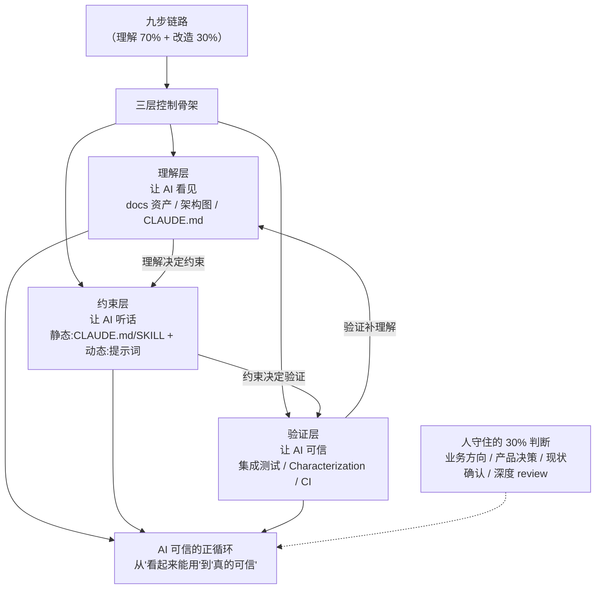

# Claude Code 企业级老项目改造实战 学习指南

> 一句话价值：老项目改造的本质是"理解 + 开发"，AI 只改变分工不改变链路；用"理解→约束→验证"三层骨架 + 一整套可复制的提示词工作流，把改造质量稳定在 80 分以上——前提是你守住 AI 做不到的 30% 判断。

## 课程画像
- 讲师：Robert（资深工程师，个人经历导向，无公开履历背书；课程引用业界资料但数据可验证性低）
- 适合人群：正在用 AI 改公司老项目的工程师；对"AI 写代码不放心"想建立验证体系的团队；想让 AI 承担重复流程但又怕失控的中级开发者
- 不适合人群：纯 AI 编程新手（需要先会用 Claude Code）；想学具体工具快捷键的人（本课明确"工作流为先、工具补位"）；期待 AI 全自动托管改造的人（本课立场恰恰相反）
- 投入时间：推荐 8-12 小时（方法论文本 5 小时 + 实操课 4 小时 + 自己动手 3 小时）
- 价值密度：⭐⭐⭐⭐（4.1/5）——方法论密度高，但 5 节实操课重复、数据可信度低

## 阅读路线

### 路线 A：快速浏览（30 分钟）
只需读以下 5 讲（金矿，全部精读）：
- [15] 补出兜底测试 — 全课最硬的技术方法论：Characterization Test 锁行为
- [17] 需求六维 + AI 能力地图 — 拆需求的完整体系
- [20] 前端翻车复盘 — "人是最后的兜底员"，全课最值钱的一课
- [22] 核心五问 — "AI 是加速不是兜底"，三个失败模式自检
- [25] 两次翻译 — 把一句话需求拆成可动手方案的方法论

### 路线 B：深度阅读（2 小时）
在路线 A 基础上，补充银矿：
- [01] 九步链路 — 理解 70/30 与冷启动飞轮，A 路线的认知底座
- [03] 三层控制 — 理解/约束/验证骨架，串联所有方法
- [10] CLAUDE.md 禁区/历史包袱 — 为什么这两节必须人写
- [11] SKILL 三特征判断法 — 挖不是设计
- [18] 方案七步走 — 从需求到方案的完整模板

### 路线 C：时间充裕（5 小时）
全部金矿 + 银矿 + 按需浏览铜矿：
- [06] 八步心法、[08] 三张图 — 了解项目框架
- [13] 环境工程师、[14] 摸底四步 — 改造前护栏
- [19] 后端执行、[23] 二次演练 — 改造执行与可迁移性
- 实操课 [12][16][21] 可快进看提示词，[29][32] 可跳过

## 核心知识地图（按主题重组，非原课程顺序）

### 主题一：AI 协作的认知底座——链路没变，分工变了

**一句话总结**：老项目改造的九步链路从有软件工程起就是"理解 + 开发"，AI 没有推翻它，只是改变了每一步里人和 AI 的分工；你要守住的不是写代码，是 AI 做不到的那 30% 判断。

**关键框架**：

1. **九步链路 + 70/30 比例**（来源：01 讲）：找人聊→翻资料→看代码→搭环境→curl 冒烟→深挖→画链路→动手改→验收。前六步是理解，后三步是改造——**70% 的时间花在理解上**。跳过前六步直接让 AI 改，AI 就是瞎的（没上下文）。冷启动永远慢，但理解越深后续改造越快，形成复利飞轮。

2. **三档分工**（来源：02 讲）：AI 主导做 80%（读文档/梳理接口/画图）、人机对半做 50%、人主导 AI 做 20% 或更少（决策/验收/现状确认）。金句：**"20% 的盲区，经常就是 100% 的事故"**——AI 做不到的那 20%，你不主动补，它就是 0。

3. **三层控制：理解-约束-验证**（来源：03 讲，与 Anthropic Harness Engineering 同构）：

**可操作方法**：
1. 接手项目先走前六步，把理解结果整理成文档再交给 AI（来源：01 讲）
2. 每次协作自检三层：AI 看见了吗 / 约束写了吗 / 有独立基准吗（来源：03 讲）
3. 动态约束写进每次提示词："只改这三个文件，其他一律不动"（来源：03 讲）
4. 用"工作量下来 ≠ 思考量下来"审查自己：省下的时间有没有投到判断上（来源：22 讲）

**金句**：
> "AI 是加速，不是兜底。工作量下来 ≠ 思考量下来——如果你节省的时间没有用在思考上，你就只是在更快地走错路。" — 22 讲

### 主题二：老项目资产化——从 docs 五份资产到 CLAUDE.md 与 SKILL（理解层落地）

**一句话总结**：让 AI 可信的第一步是让它看见——把项目的隐性知识显性化为 docs 资产，再凝成 CLAUDE.md（索引+常识），把重复流程挖成 SKILL（操作资产），形成"踩坑→沉淀→复用"的闭环。

**关键框架**：

1. **docs 五份资产**（来源：08/09 讲）：架构图（系统级共识）、模块图（代码级依赖）、依赖图（生态级牵挂）、REST 接口清单、数据模型。生成纪律：**让 AI 读真实文件不脑补**（扫 Controller/entity/建表 SQL），产出后互相校对保证自洽。

2. **CLAUDE.md = 索引 + 常识**（来源：10 讲）：放项目定位/核心架构/关键模块/关键约定/怎么跑/禁区/历史包袱，不放完整细节（用链接指向 docs）。超 300 行就是写多了。**禁区与历史包袱必须人写**——这两节信息不在代码里、只在人脑子里，AI 猜不出来；"让 AI 留空这两节"是防止 AI 瞎编的提示词技巧。

3. **SKILL 是挖出来的，不是设计出来的**（来源：11 讲）：三特征判断法——**可复制**（反复做）、**可参数化**（只有变量变）、**可自动化**（有明确起止），三条全满足才写。数量克制（≤5 个），避免"一句话匹配多个 SKILL"的触发歧义。老项目四大富矿：文档自动更新、改造前体检、PR 前检查、新增接口对齐。

**可操作方法**：
1. 用"AI 起稿 + 你把关 + 留下资产"的三段式做所有理解类产出（来源：07/08 讲）
2. 给自己项目列禁区与历史包袱各几条——列不出说明理解还不够深（来源：10 讲）
3. 用"让 AI 分析项目重复流程"的提示词生成 SKILL 候选清单，按三特征筛选（来源：11 讲）
4. 翻车教训写进 CLAUDE.md 变成下次护栏（来源：20 讲）

**金句**：
> "老项目 CLAUDE.md 写得好不好，就看'禁区'和'历史包袱'这两节写得深不深。其他内容 AI 都能帮你生成，这两节必须你自己投入时间。" — 10 讲

### 主题三：改造前护栏——环境、测试与 CI（验证层落地）

**一句话总结**：改造前把三件事做掉——环境能跑、测试能兜、CI 自动守；其中 Characterization Test"锁住现在实际做什么"是 AI 时代对抗"沉默的行为偏移"的刚需。

**关键框架**：

1. **环境工程师四步**（来源：13 讲）：依赖盘点→本地安装（主推）/启停脚本/Docker（备选）→编译启动→接口冒烟。所有踩坑沉淀为 setup-guide.md + env-bootstrap SKILL，把一次性工作变长期资产。

2. **摸底四步**（来源：14 讲）：摸核心链路→摸现有测试→跑一遍看实际状态→算出缺口清单（test-gaps.md，P0/P1 分级）。纪律：**不要让 AI 大而全**——护栏不是覆盖率指标，是改造路径关键节点都有兜底。

3. **Characterization Test 与补测试体系**（来源：15 讲，方法出自 Michael Feathers《Working Effectively with Legacy Code》）：
   - 断言纪律：**凭"实际是什么"写，不凭"应该是什么"写**——AI 写测试有隐性偏差，会用业务直觉补断言，把"历史包袱"当成 bug
   - 优先级：改造路径 Characterization > 核心链路集成 > 复杂逻辑单元 > 简单 CRUD（可不补）
   - 节奏：每批 1-3 个（最好 1 个），跑通一批 review 一批，防止"整批不可信"
   - 收尾：CI 自动跑，测试从"个人资产"变"团队级护栏"

**可操作方法**：
1. 改造前 30 秒兜底：先点产品确认"要做的功能不存在"（来源：20 讲，全课最值钱的动作）
2. 改代码前先写 Characterization Test 锁行为，改造后跑一遍对比（来源：15/19 讲）
3. 让 AI 出 CI workflow 时核对：触发条件、中间件 services、JDK 版本读 pom.xml（来源：15 讲）
4. 拒绝"一口气补 20 个测试"——失败率高的批次先查是不是断言基于"应该"（来源：15 讲）

**金句**：
> "AI 写测试 = 不再有借口拖延。以前不补是因为成本太高，现在 AI 把成本降到零。从今天起，改造前没护栏，不能再怪工作量了，只能怪自己的判断。" — 15 讲

### 主题四：从一句话到交付的改造工作流（需求→方案→执行→复盘）

**一句话总结**：一句话需求 → 需求六维（AI 做数据层、人补三个判断）→ 方案七步（AI 调研、人审决策点）→ 小步执行（锁行为+测试）→ 复盘把教训写回资产；全程的关键是"该停的地方必须停"。

**关键框架**：

1. **需求六维 + AI 能力地图**（来源：17 讲）：业务目标/用户场景/接口契约/边界场景/老项目约束/不在范围。**AI 强的维度**（接口契约、技术 edge case、老项目约束，85+ 分）交给 AI；**AI 弱的维度**（业务方向、产品决策、范围裁剪，30- 分）必须人拍。三步走：AI 出六维草稿（强制读 docs+CLAUDE.md+代码）→ 人补三个判断 → AI 出定稿，全程约 20 分钟。

2. **方案七步走**（来源：18 讲）：摸链路（HTTP 到 DB）→ 列改造点（P01-P10）→ 画流程图 → 影响范围（风险分级）→ 改造步骤（按依赖排序）→ 整合成方案 → **Step 7 决策点审核（人）**。两个提示词技巧：**显式考虑前端**（AI 默认只看后端）、**有分歧才给方案**（防 AI 过度调研）。

3. **执行四原则**（来源：19 讲）：先锁行为 → 小步执行 → 自主修复+3 次兜底 → 不破坏现有行为（改造前后测试一致）。

4. **三个失败模式**（来源：22 讲，效果不好的 99% 归因）：①17 讲拆需求偷懒（业务目标用 AI 的/待决策没问产品/范围没拍板）；②18 讲跳过 Step 7 决策点审核；③跳过现状确认（没点产品）。自检：业务目标是你写的吗？决策点你真审了吗？开工前你点过产品吗？

**可操作方法**：
1. 拆需求用六维模板+三步法，人只守三个判断（来源：17 讲）
2. 方案阶段让 AI 显式列前端改造点并标"现有/新建"（来源：18 讲）
3. 执行前先写 Characterization Test，小步提交（来源：19 讲）
4. 复盘时用三个失败模式对照自己的最近一次改造（来源：22 讲）

**金句**：
> "AI 扫代码再细也不能替你点几下产品看现状。人不只是决策员，还是兜底员。" — 20 讲

### 主题五：跨场景变体——学习新工具、两次翻译、开源贡献

**一句话总结**：方法论骨架换场景照跑：学新开源项目用"三问框架+带任务问"；接一句话需求用"两次翻译"（问题域/方案域分离）；开源贡献用"AI 当助教+小步高频"。

**关键框架**：

1. **学习框架**（来源：24 讲）：有自己的拆解框架（它是什么/能做什么/怎么扩展）+ 带着任务去问（不是裸问），跑完回官方文档对照纠错。

2. **两次翻译**（来源：25 讲）：第一次翻译——一句话需求 → 与技术栈无关的完整设计文档（做什么/不做什么/给谁用）；第二次翻译——设计 → 落到具体工具的方案文档。**第二次翻译前先反问"路径选错了吗"**（用对新工具的认知质疑旧方案）。技巧：反问不是追问（有预期基准才指出 AI 漏了什么）；收敛不是展开（"别又冒新决策，把这版收紧"）。两份文档的因果链让每个技术决策可追溯。

3. **先跑通再读文档**（来源：26 讲）：装好→聊一聊→写 Hello World→最简 Tool/Skill→记坑→回看方案。每一步卡壳都是下一步的指路灯。

4. **开源入门**（来源：30/31/32 讲）：第一个 PR 选最简单入口（SignYourName），**走通流程比技术难度重要**；第二个 PR 让 AI 当学科助教（摸项目→筛 issue→改+测+提 PR）。开源不是技术比赛，是耐心比赛——**频次大于单次重量**，每周一个小改动。

**可操作方法**：
1. 接到一句话需求先做第一次翻译，列"拍不准的选择"让 AI 给选项（来源：25 讲）
2. 方案阶段用"别又冒新决策，把这版收紧"控制发散（来源：25 讲）
3. 新工具上手走最小闭环：先跑通再读对应章节（来源：26 讲）
4. 开源用"每周一个小改动"替代"憋大招"（来源：32 讲）

**金句**：
> "接到需求当天就开始写代码的人，没一个交付得好。写文档的过程本身就是把需求里所有藏着的事拍清楚的过程。" — 25 讲

## 可忽略内容
以下章节信噪比 < 2.0，可直接跳过：
- [29] 实操：42 分钟纯演示，重复 24-28 提示词，独立增量极少
- 热点速递：时事评论，与课程方法论弱相关
- 开篇词 / 结束语 / 结课测试：开场白、鸡汤、测试入口

以下章节按需浏览（铜矿，2.0-2.9，作为背景参考）：
- [04] 武器库（工具罗列易过时，只记"够用就停"）、[05] 业界全景（三个债框架有价值但**数据大量无法验证**，引用前必须回原始来源）
- [07][08][09] 画图与接口清单（教程级，样例文档撑篇幅）
- [12][16][21] 实操课（演示性质，快进看提示词即可）

## 延伸阅读
- **书籍**：Michael Feathers《Working Effectively with Legacy Code》（2004）——Characterization Tests 与 Seam 的源头，AI 时代重新成为刚需（05/15 讲多次引用）
- **论文**：Chain of Understanding（Jie Gao 等，ICPC 2026，arXiv:2504.04553）——专家读代码的"全局→局部→关系"螺旋链（05 讲）
- **业界报告**：Sonar State of Code Developer Survey、Veracode GenAI Code Security Report——AI 代码可信度数据（⚠️ 引用前核实数值）
- **本课程原文**：金矿讲 15/17/20/22/25 建议逐字精读，见 digest/README.md 导航
