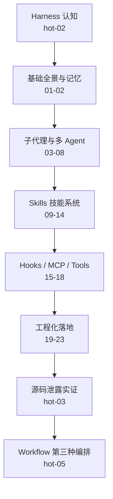

# 《Claude Code 工程化实战》一页纸

> 34 讲 / 约 9.9 小时 / 讲师黄佳。消化结论：不是"工具说明书"，而是一张从 CLI 走向 Agent 运行时的工程地图；金矿只有 2 讲，但足够值回票价。

## 1. 这门课讲什么

把 Claude Code 当作 **Harness（模型外面的运行时）** 而非命令行工具，围绕"工具、上下文、记忆、Hooks、权限"五个组件，讲清 Sub-Agents、Skills、MCP、Headless、Rules、Agent SDK、Plugins 的配置与边界。核心主张：**学概念不学工具，复杂度用结构消化，而不是换更聪明的模型。**

## 2. 值不值得读

**SNR 2.92/5**：金 2、银 17、铜 10、铁 5。47 条量化声明中 ✅33 / ⚠️10 / ❓2 / 🚩2。**适合**：已用 Claude Code、想把个人技巧升级为团队级 Agent 系统、质量门禁与 CI 集成的工程师。**不适合**：零基础读者、只要按钮速查的人、只关心稳定 API 的人。最优路径：hot-03 → 04 → 16 → 20/11 → 19，约 4 小时拿到 80% 价值。

## 3. 精华讲清单

| 讲 | 讲题 | 一句话结论 | 为什么值得 |
|---|---|---|---|
| hot-03 | 源码泄露实证 | 十点验证课程架构推测，Harness 本身就是 IP | 全课唯一"黑箱→白箱"的实证 |
| 04 | 多 Agent 工程指南 | 四模式 + 决策树；隔离是第一价值，不是并行 | 把架构玄学变成可操作判据 |
| 16 | Hooks 高级模式 | 检查通过才算做完，Stop Hook 做交付门控 | 工程密度最高，可直接复制 |
| 20 | Rules 规则系统 | 指令规则是员工手册，权限规则是门禁 | 软硬约束二分最精准 |
| 11 | 渐进式披露 | 目录/章节/附录三层，按需加载知识 | 复杂 Skill 的通用架构 |
| hot-05 | Workflow | 控制流在脚本而非上下文，确定性换复用 | 概念层面的真洞见 |
| 09 | SKILL.md 结构 | description 不是说明书，是触发器 | 决定 Skill 能否被自动调用 |
| 18 | Tools 内核 | 五个原子操作 + 涌现，Bash 是逃逸舱 | 理解工具设计哲学 |
| 19 | Headless CI/CD | 无人值守的第一原则是最小权限 | 马上能接入流水线 |
| 22 | Agent SDK 高级 | 四层权限防线 + 运行时 canUseTool | 生产级 Agent 的安全骨架 |

> 另 9 篇银矿（03/06/07/08/10/14/15/17/21）见 `content_triage.json`，按需选读。

## 4. 核心概念依赖图

Harness（模型 + 工具 + 上下文 + 记忆 + 权限）→ Agentic Loop（推理→工具→回注）→ 上下文隔离（Sub-Agent）→ 能力按需加载（Skill 渐进披露）→ 行为约束（Hooks 硬拦截 + Rules 软规范）→ 编排升级（Teams 互通 / Workflow 外置控制流）→ 工程化（Headless / SDK / Plugins）。**前一层没跑顺，不要跳到下一层。**

## 5. 金句与方法论

1. Agent = Model + Harness；模型负责推理，Harness 负责手脚、记忆与边界。
2. 先单 Agent，再加工具，最后才加 Agent。
3. 多 Agent 的第一价值是上下文隔离，不是并行。
4. 选对模型，胜过把 token 预算翻倍。
5. 上下文窗口是稀缺资源，注意力会被噪声稀释。
6. 高级工具是原语组合涌现出来的，不是内置出来的。
7. description 是触发器，不是介绍文案。
8. 指令规则是员工手册，权限规则是门禁系统。
9. 检查通过了才算做完，而不是做完再检查。
10. 最好的架构不是最复杂的，而是恰好够用的最简架构。

## 6. 略读清单

- **开篇词 / 直播回放 / 结束语 / 结课测试（4 讲）**：课程定位与鸡汤，无技术增量。
- **hot-01 / hot-04（2 讲）**：OpenClaw 拆解与范式 3.0，营销属性重，观点密度低。
- **01 / 02（2 讲）**：五层架构与 CLAUDE.md，可当背景，细节已被 hot-03 超越。
- **05 / 12 / 13 / 21 / 23（5 讲）**：演示型或文档复述，读配套代码即可。
- **两篇专题总结（2 讲）**：复习 + 作业，无新知识。
