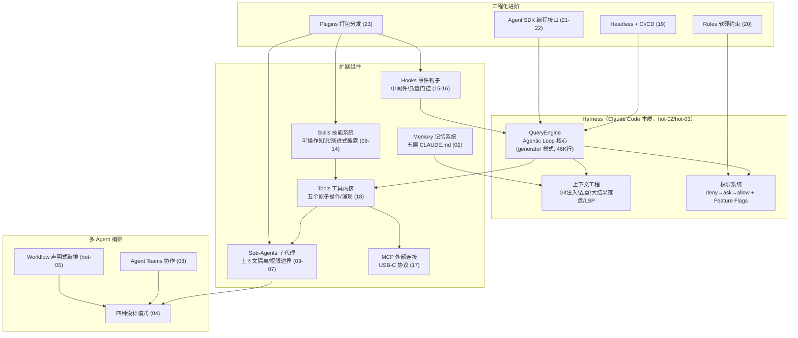

# 《Claude Code 工程化实战》学习指南

> 一句话价值总结：**Claude Code 不是一个 CLI 工具，而是一个可编程、可扩展、可组合的 AI Agent 框架（Harness）**——本课程教你用架构思维驾驭它：什么时候用子代理、怎么写 Skill、怎么设安全门禁、怎么让它在 CI 里无人值守。
> 价值密度：⭐⭐⭐⭐ (SNR 2.92/5，金矿 2 / 银矿 17 / 铜矿 10 / 铁矿 5)

## 课程画像
- 讲师：黄佳（佳哥），极客时间资深讲师，前作《MCP和A2A前沿实战》
- 适合人群：正在用 Claude Code 写代码、想升级为"构建 Agent 系统"的工程师；需要把 AI 接入团队工程流程（CI/CD、代码审查、质量门禁）的团队技术负责人
- 不适合人群：完全没写过代码的读者；只想"点开即用"的工具党（本课程强调结构思维，不是快捷键手册）；对 2026 年热点叙事不感兴趣、只要稳定 API 文档的人
- 投入时间：推荐 6-8 小时（快览 30 分钟 / 深度 2 小时 / 完整 6 小时）
- 时效性警示：Agent Teams、Workflow 为实验/预览功能；Skills 生态数据（27+ 平台、52,000+ Skills）为课程出版时点快照，引用需标注时间

## 阅读路线

### 路线 A：快速浏览（30 分钟）——只读 3 讲
- [hot-03] 真相大白：源码泄露 → 用真实源码验证架构，全课最硬核的一讲，先建立"Harness 是 IP"的认知
- [04] 量体裁衣：Multi-Agent 工程指南 → 四种模式+决策树，一讲看懂多 Agent 选型
- [20] 有章可循：Rules → 软硬约束二分法，理解 Claude Code 的行为约束体系

### 路线 B：深度阅读（2 小时）——加 6 讲
- [hot-02] Harness 架构深度解析 → Harness 概念体系（先于 hot-03 读更顺）
- [hot-05] Workflow：编排载体 → 控制流位置框架，理解编排原语
- [03] Sub-Agents 核心概念 → 上下文污染+权限配置
- [11] 渐进式披露 → Skill 架构方法论
- [16] Hooks 高级模式 → 质量门控体系
- [19] Headless 与 CI/CD → 无人值守实战

### 路线 C：时间充裕（6 小时）——全部金矿+银矿
在上面的基础上补：[09] SKILL.md 结构、[10] 任务型 Skill、[15] Hooks 基础、[18] Tools 内核、[22] Agent SDK 高级、[08] Agent Teams、[06] 高噪声处理、[07] 并行流水线、[14] 行业标准

## 核心知识地图（按主题重组，非原课程顺序）

### 主题一：Harness 架构——Claude Code 的本质（hot-02 / hot-03 / 18 / 01）

**一句话总结**：Claude Code 是包裹在 Claude 模型外面的 agentic harness——提供工具、上下文管理、执行环境与权限控制，把一个"只会输出文本"的模型变成"能行动"的编码 Agent；且 Harness 本身是 Anthropic 的商业 IP。

**关键框架：Agentic Loop 与 Harness 组件**
Claude Code 的运转核心是 Agentic Loop："推理 → 工具调用 → 结果回注 → 继续推理"，直到模型主动停止或无工具可调。源码证实（hot-03）这个循环在 Claude Code 里叫 **QueryEngine**（46K 行单例），用 generator 模式实现——天然流式输出、Ctrl+C 中断干净、可嵌套递归。Harness = 工具（手脚）+ 上下文管理（记忆）+ 执行环境（躯干）+ 权限控制（免疫系统）。

**上下文工程是真正的秘密武器**（hot-03 实证）：同一个 Claude 模型在 Claude Code 里表现远超裸 API，原因不在模型而在提示构造——①Git 上下文自动加载（分支/commit/diff）；②静态/动态内容分界标记（静态部分走缓存）；③文件读取哈希去重；④大结果落盘（grep 出几千行写临时文件，上下文只留摘要+路径）；⑤LSP 语义级代码理解。**如果你遇到"上下文爆了"，往往是你搜索条件太宽泛，不是工具的问题。**

**五个原子操作**（18）：Claude Code 的工具集不是特化能力，而是一组原语——感知（Read）、搜索（Grep/Glob）、修改（Edit/Write）、执行（Bash）、获取（WebFetch）。"重构/测试/部署"都是原语组合的**涌现**。给 Claude 一个"重构工具"反而有害：重构是一系列决策的集合，把决策权交给模型推理比交给固定逻辑更灵活。Bash 是图灵完备的"万能逃逸舱"，但专用工具存在三原因：结构化交互、权限精细控制、Token 效率。

**可操作方法**：
1. 用裸 API vs Claude Code 跑同一任务，感受 Harness 的差距（hot-02 动手实验）
2. 排查上下文爆掉：先收窄 grep 条件，而不是抱怨工具（hot-03）
3. 配置权限用 deny→ask→allow 顺序 + Bash 通配符 `Bash(npm run *)`（18）

**金句**：
> "同一个模型在不同 Harness 中的表现差距，远大于不同模型在同一个 Harness 中的差距。" — hot-02
> "Harness 不仅是用户和模型之间的桥梁，也是 IP 保护的前线。" — hot-03

### 主题二：多 Agent 设计与编排（04 / 03 / 07 / 08 / hot-05）

**一句话总结**：多 Agent 不是越复杂越好——从单 Agent 起步，遇到明确瓶颈再升级；选型第一问是"workers 之间要不要通信"。

**关键框架：四种设计模式 + 升级决策树（04）**
| 模式 | 机制 | 适用 |
|------|------|------|
| Sub-Agents | Supervisor 委派，上下文隔离 | 多领域独立上下文、信息过滤 |
| Skills | 单 Agent 渐进加载能力 | 能力多但单次用少量 |
| Handoffs | 状态驱动 Agent 切换 | 多阶段流程（客服工单） |
| Router | 语义分类+并行分发+合成 | 跨数据源查询 |

决策树：单一领域+工具<5+上下文<50K → 单 Agent 即可；工具>10 → Skills；多领域独立上下文 → Sub-Agents；多步骤状态流转 → Handoffs；跨数据源并行 → Router。**铁律：先加工具，再加 Agent。**

**量化数据（✅可引用）**：Anthropic 多 Agent 研究系统比单 Agent 提升 90.2%，代价是约 15 倍 token 消耗（Anthropic 官方博客）；多领域查询中上下文隔离模式节省 40%+ token（LangChain 测试）。95% 性能波动归因：token 使用 80% + 工具调用与模型选型 15%。

**子代理第一价值是上下文隔离**（03）："你觉得 Claude Code 越用越健忘，不是模型退化了，而是上下文被中间过程污染了。"子代理 = 把日志、搜索、试错移出主对话，主对话只保留决策信息。配置三件套：白名单 tools / 黑名单 disallowedTools / permissionMode。

**并行与流水线**（07）：**独立→并行，依赖→流水线**。交接处设计"交接契约"（阶段间明确的信息格式），防信息丢失。混合模式=部分独立+部分依赖。

**Agent Teams：需要互相通信时才用**（08）：Sub-Agents 只能向主对话汇报；Teams 的 Teammates 可互发消息、挑战结论。四大协作模式：竞争假设（用辩论对抗锚定偏见）、分层评审、模块化开发、规划-审批。选型：只需汇报 → Sub-Agents（便宜）；需要讨论 → Agent Teams（贵）。⚠️ 实验性功能，生产慎用。

**Workflow：控制流在哪决定一切**（hot-05）：Sub-Agent 模式控制流在 Claude 上下文（临场判断、不可重复）；Workflow 控制流在脚本（静态、可重复、可大规模并行、可固化质量）。代价：不接受中途输入、orchestrator 无 IO 权限、生成脚本耗 token。四维决策：流程稳定+规模大+可复用+可一次性跑完 → 才值得 Workflow。

**可操作方法**：
1. 用决策树审自己现有 Agent 项目：引入多 Agent 是真瓶颈还是"看起来专业"？（04 思考题）
2. 多 Agent 上生产四防：输出端设检查点（防失败级联）、生产链路追踪、彩虹渐进部署、异步化（04）
3. 高噪声命令（输出>50 行且只关心<10 行）→ 配子代理消化，三层输出格式"结果→细节→建议"（06）

**金句**：
> "Agent 的复杂度，不是靠'更聪明的模型'解决的，而是靠'更好的结构'消化的。" — 04
> "多 Agent 的第一价值不是并行，是隔离。" — 04

### 主题三：Skills 知识工程（09 / 10 / 11 / 12 / 13 / 14）

**一句话总结**：Skills = 企业 SOP 的可操作知识体系——把组织规范变成 AI 可按需查阅的 Markdown 知识包；description 是触发器，不是说明文档。

**关键框架：参考型 vs 任务型 + 渐进式披露三层架构**
- **参考型**：Claude 自动判断何时加载（description 写"什么时候该用此技能"的自然语言条件）→ 知识按需注入
- **任务型**：用户手动触发（disable-model-invocation: true），斜杠命令 `/commit` `/review`；七步设计清单：动作→命名 / 触发→用户 / 权限→命令级 allowed-tools / 上下文→!command 预注入 / 安全网→hooks / 输出大→context:fork / 模型→haiku/sonnet
- **渐进式披露（11）**：目录页（description，只做路由）→ 章节（SKILL.md 主文件）→ 附录（reference/templates/data/scripts 按需加载）。**Quick Reference 路由表**是核心技巧：用"用户可能说的关键词"当路由条件（3 行表格≈50 tokens 直达目标文件），每行一个条目、不超过 10 条、高频在前

**精确授权原则**（10）：`allowed-tools: Bash(git status:*), Bash(git commit:*)` 而非 `Bash(*)`——命令级白名单，拒绝全权委托。

**Skills 为什么出圈**（14）：三个本质属性——声明式（纯 Markdown，任何 LLM 能读）、自包含（文件夹即一切，git clone 即安装）、知识本位（价值在内容不绑平台）。对比：SubAgents 封装行为所以绑平台，Skills 封装知识所以跨平台。**Push vs Pull 场景矩阵**：知识量少(<8KB)+每次都要 → CLAUDE.md/AGENTS.md（Push）；知识量大(>50KB)+偶尔需要 → Skills（Pull）；正确做法是组合。

**Skills × SubAgent 组合**（12）：方向 A = SubAgent 包含 Skill（skills 字段，预加载领域知识）；方向 B = Skill 包含 SubAgent（context: fork，Skill 派生子代理）。三种模式：预加载 / context:fork 直接应用 / 流水线分工。

**可操作方法**：
1. 写参考型 Skill：description 用"Use when user asks about…"句式（09）
2. 复杂 Skill 三层结构：SKILL.md 路由表 + reference 公式文件 + scripts 计算脚本（11）
3. 用"同事 5 分钟理解、10 分钟使用、30 分钟产出"验收你的 Skill（bonus-skills）

**金句**：
> "Skills 的 Description 不只是说明文档，而是触发器。" — 09
> "把你的 Skill 目录复制给一个从没见过它的同事，他能不能在 5 分钟内理解它做什么、10 分钟内开始使用、30 分钟内产出符合团队标准的工作成果。" — bonus-skills

### 主题四：自动化质量与安全防线（15 / 16 / 19 / 20 / 22）

**一句话总结**：无人值守的 AI 自动化，安全责任全在配置端——Hooks 拦截、Rules 约束、权限分层，构成纵深防御。

**关键框架：Hooks = AI 时代的中间件（15/16）**
Hooks 是三大扩展机制中唯一能**拦截和修改** Claude 行为的机制。事件体系分三阵营：控制点（PreToolUse/Stop/SubagentStop，能阻止）、观测点（PostToolUse 等）、通知点。四种执行类型：command（确定性，正则匹配）、prompt（LLM 判断，做第二层审查）、compact、mcp。

**Stop Hook 质量门控（16，全课工程密度最高）**：把质量保证从事后检查变成交付前置条件——**"检查通过了才算做完"**。核心是 `continue: true`：Claude 认为完成 → Stop Hook 跑测试 → 失败则 block+continue → Claude 继续修 → 直到通过才允许停。配套 `stop_hook_active` 防死循环（允许重试一次，二次失败放行）。Prompt 类型 Hook 让 Haiku 当审查者，双 AI 视角发现"作者盲区"。

**Headless 与 CI/CD（19）**：`claude -p` 无人值守 + 三种输出格式（text/json/stream-json）+ Unix 管道集成。**"AI 代理不会主动判断操作是否安全，安全责任在配置端"**：--allowedTools 白名单 + --max-turns 控成本 + 权限配置兜底。GitHub Actions 官方 Action 让"AI 代码审查"几行 YAML 就能落地。

**Rules 软硬约束（20）**：指令规则（.claude/rules/）= 员工手册，约束认知，软，可违背；权限规则（settings.json）= 门禁系统，约束行为，硬，强制执行。paths 条件加载细节：**一旦加载就不会卸载**——paths 控制何时加载，不是何时生效。

**SDK 四道防线（22）**：权限模式（全局基调）→ canUseTool 回调（运行时动态裁决）→ Hooks（执行前拦截）→ settings.json（配置兜底）。`@tool` 装饰器定义自定义工具（本质是进程内 MCP 服务器，低延迟）；流式会话是生产首选（中断/取消/动态切换权限）。

**可操作方法**：
1. 复制 run-tests.sh 配置 Stop Hook 测试门控（16 实战，注意 jq 依赖）
2. PreToolUse 拦截危险命令：正则匹配 rm -rf/curl/mkfs，exit 2 拒绝（15）
3. CI 最小权限三件套：--allowedTools + --max-turns + 权限配置（19）
4. 团队规则拆分：常驻放 CLAUDE.md，大块规范按 paths 条件加载放 rules/（20）

**金句**：
> "把质量保证从'事后检查'变成'交付前置条件'——不是做完了再检查，而是检查通过了才算做完。" — 16
> "指令规则像员工手册，权限规则像门禁系统——没有卡就进不了机房，系统不给你选择。" — 20

### 主题五：MCP 连接外部世界（17）

**一句话总结**：MCP = AI 的 USB-C 接口，一个开放协议取代 M×N 个适配器，让 Claude 从本地文件系统扩展到整个数字世界。

**关键框架**：M×N 碎片化问题（M 个助手 × N 个服务 = M×N 个专用适配器）→ 统一协议。三种传输：stdio（本地）、HTTP（远程）、SSE。5 条安全原则。可自定义服务器（TS/Python SDK）。

**可操作方法**：Context7 实时文档 / GitHub MCP / Notion / 数据库四个实战配置（17）；自定义 MCP 服务器用 Python SDK。

**金句**：
> "MCP 让 Claude 的能力边界从本地文件系统扩展到了整个数字世界。" — 17

## 课程核心概念关系图（Mermaid）

## 可忽略内容（信噪比 < 2.0，直接跳过）
- [intro] 开篇词 — 纯叙事+课程地图，无知识
- [live] 直播回放 — 视频索引，无正文
- [hot-04] AI 工程范式 3.0 — 纯视频+行动营推广页
- [outro] 结束语 — 心路鸡汤
- [quiz] 结课测试 — 测试指引页
- [bonus-subagent] / [bonus-skills] 加餐总结 — 回顾+作业布置（可扫一眼验收标准）

## 延伸阅读
- **官方文档**：Anthropic [Harness 工程博客](https://www.anthropic.com/engineering/effective-harnesses-for-long-running-agents)、[多 Agent 研究系统](https://www.anthropic.com/engineering/multi-agent-research-system)、Claude Code [Skills](https://code.claude.com/docs/en/skills) / [Hooks](https://code.claude.com/docs/en/hooks-guide) / [Agent Teams](https://code.claude.com/docs/en/agent-teams) / [Workflows](https://code.claude.com/docs/en/workflows)
- **外部来源**：LangChain《Choosing the Right Multi-Agent Architecture》、Lilian Weng《LLM Powered Autonomous Agents》(2023 奠基综述)、Parallel.ai《What is an Agent Harness》、eesel.ai《Claude Code Automation》、Vercel《AGENTS.md outperforms skills in our agent evals》
- **书籍**：黄佳《Agent设计模式》（课程 04 讲推荐）
- **延伸主题**：Agentic AI Foundation（AAIF）三大项目 MCP/goose/AGENTS.md、skills.sh 包管理器、KAIROS 守护进程模式（Claude Code 下一进化方向）

## 数据可信度警示（引用前必读）
- 🚩 禁止引用：token 利用率提升 98%（11 讲释题，无出处夸大）；功能代码:安全代码≈1:3（hot-03，讲师估算）
- ❓ 谨慎引用：27+ 平台/52,000+ Skills/180,000 安装量（14 讲，课程出版时点生态数据）；Claude Code 81K stars/OpenCode 119K/10 亿美元年化（hot-02）；Claw-Code 2 小时 50K stars（hot-03）；50 行法则（06，讲师经验）
- ⚠️ 标注语境：90.2%/15x token（04，Anthropic 官方博客✅可引）；40% token 节省（04，LangChain 测试转述）；泄露细节数字（hot-03，事件真实但数字无法独立核实）
