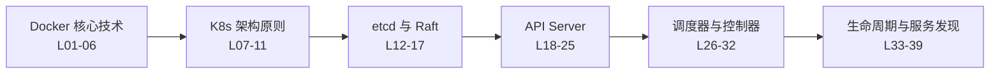

# 《Docker 与 Kubernetes 核心技术深入解析》一页纸

> 39 讲、约 21.6 小时的 K8s 控制平面原理课，以"为什么这样设计"为主线，6 讲金矿全是生产故障叙事。别顺序刷，按金矿地图策略性精读。

## 课程地图

## 值不值得读

- SNR 3.42/5.0（金 6 / 银 23 / 铜 10 / 铁 0）
- 适合：1 年以上容器/K8s 经验的运维与研发、平台建设者。价值不在"怎么用"而在"为什么这样设计"，故障案例可直接迁移到排障与架构决策。
- 不适合：零基础入门者（需先自备集群）、只要操作手册的纯用户。注意：过半量化数据为讲师内部经验（❓），引用须标注"据讲师称"。

## 精华讲清单

| 讲 | 讲题 | 一句话结论 | 级别 |
|----|------|-----------|------|
| 16 | 高可用集群管理 | list 不带 resourceVersion 会穿透堵死 gRPC；横向扩容反而降写性能 | 金 4.2 |
| 17 | etcd 常见问题 | 假健康检查（只看端口）引发大规模误驱逐；FMA 故障注入方法论 | 金 4.1 |
| 26 | 调度器 kube-scheduler | request≠limit=超售；Taint 是门禁；应用炸弹可循环摧毁集群 | 金 4.1 |
| 30 | 容器网络接口 CNI | Calico 全 1 MAC 虚拟网关；BGP mesh 指数膨胀→RR 星状化 | 金 4.0 |
| 33 | Pod 生命周期 | bash 吞 SIGTERM 破坏优雅终止；Liveness 乐观/Readiness 悲观 | 金 4.2 |
| 39 | Ingress+Service 案例 | 切流靠 LB 不靠 DNS；ECMP/DSR 做横向扩展与回程优化 | 金 4.0 |
| 03/04 | Docker 核心技术一二 | Namespace/cgroups/CFS 与 OverlayFS 写时复制机制 | 银 |
| 05/06 | 容器网络/Dockerfile | veth/VXLAN 实验；缓存、多段构建、tini 踩坑 | 银 |
| 07/08/09 | 架构基础+ kubectl | Borg 混布数据可溯源；声明式四原则提炼出色 | 银 |
| 13/14 | Raft 协议及实现 | 选主+日志复制原理；WAL/MVCC/match index | 银 |
| 20/21/22/23/24 | API Server 四道门 | 重试风暴复盘；RBAC 权限坑；APF Shuffle Sharding | 银 |
| 27/28/29/31 | 控制器/kubelet/CRI/CSI | 队列只放 key 的最终一致性；pause Sandbox；接口标准之争 | 银 |
| 34/35/36/37/38 | 服务发现全家桶 | iptables 概率链 vs IPVS；enableServiceLinks 踩坑 | 银 |

## 核心概念依赖

- 声明式 API（Spec/Status）→ 控制器模式（watch-队列-worker）→ 调度器/kubelet/kube-proxy/operator 全是同一骨架的变体
- Namespace/cgroups/OverlayFS → 容器 → Pod → CRI/CNI/CSI 标准接口 → Service/Ingress 服务发现

## 金句与方法论

1. "list 务必带 resourceVersion 信任缓存，否则穿透 etcd 堵死共享 gRPC 连接"（L16）
2. "健康检查只看端口可达=假健康；关键组件故障时宁可自杀，也不伪健康拖垮业务"（L17）
3. "无指数退避的重试会把自愈变成 DDoS"（L20）
4. "bash/sh 会吞掉 SIGTERM，优雅终止就此失效；日志走 stdout"（L33）
5. "Taint 是门禁、Label 只是邀请；强隔离用 Taint"（L26）
6. "request 锁定调度、limit 限制 cgroup，差值即超售空间"（L26）
7. "切流要依赖流量必经的 LB，不能依赖 DNS——TTL 缓存滞后"（L39）
8. "etcd 遇瓶颈先查慢查询/磁盘/网络，不要默认加节点"（L16）
9. "Pod 定义 1 个容器，节点跑 2 个进程——pause Sandbox 保住网络身份"（L28）
10. "生产 kube-proxy 用 IPVS：iptables 是概率链，后端一多规则爆炸"（L36）

## 略读清单

- 讲 01/02：架构演进常识与 docker 命令演示，信息密度低
- 讲 10/11：对象模型与对象概览，官方文档复述
- 讲 12/15：etcd 概要入门与集群构建实验，教程内容
- 讲 18/19：API Server 概念与认证 demo，教程性内容
- 讲 25：apimachinery 源码走读，非研发受众性价比低
- 讲 32：Rook 第三方项目演示，与主线相关性弱
