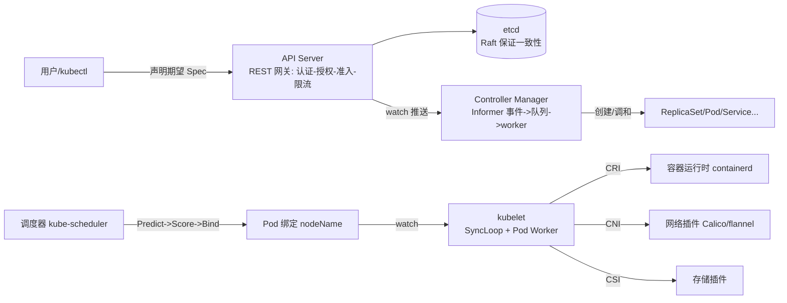

# Docker 与 Kubernetes 核心技术深入解析 — 学习指南

> 一句话价值：一门"讲设计动机与权衡"的 K8s 原理课——不教你怎么敲命令，而是讲清楚 etcd 为什么选 Raft、调度器为什么超售、为什么用 LB 而非 DNS 切流、为什么 Pod 里有个永不退出的 pause 容器；并附大量讲师亲历的生产故障案例（list 穿透、假健康误驱逐、重试风暴、SIGTERM 被吞）。

## 课程画像
- 讲师：唐炳昌（曾任职 IBM HPC、eBay、腾讯等，负责大规模 Kubernetes 平台建设与网络基础设施，L07/L21/L39 有背景自述）
- 适合人群：有 1 年左右容器/K8s 使用经验、想理解"为什么这么设计"的运维与研发；负责生产集群/平台建设的工程师
- 不适合人群：完全零基础入门者（L02/L09 只给操作概览，需要自己动手装集群）；只想学"怎么用"而非"为什么"的纯用户；对源码/机制无兴趣且时间有限者
- 投入时间：推荐 8-12 小时（金矿+银矿精读）；快速浏览 1.5 小时
- 价值密度：⭐⭐⭐⭐ (3.42/5，🥇6 🥈23 🥉10)

## 阅读路线

### 路线 A：快速浏览（1.5 小时）
只需读以下 N 节：
- [16] 高可用集群管理 — 理由：生产 etcd 运维经验与故障案例浓缩
- [17] etcd 常见问题及解决办法 — 理由：FMA 故障注入与假健康误驱逐案例
- [33] 深入理解 Pod 的生命周期 — 理由：优雅终止踩坑（bash 吞 SIGTERM）必看
- [39] 案例分享：Ingress 和 Service 网络拓扑 — 理由：全书集成案例（ECMP/DSR/99-1 权重）

### 路线 B：深度阅读（5 小时）
在读路线 A 的基础上，补充：
- [26] 调度器 kube-scheduler — 理由：request/limit 超售、Taint 门禁、应用炸弹
- [30] 容器网络接口 CNI — 理由：Calico BGP/VXLAN、IPAM 三对象、Route Reflector
- [13] Raft 协议 / [14] etcd 如何实现 Raft — 理由：分布式一致性的地基
- [27] 控制器 Controller Manager / [28] kubelet 组件 — 理由：控制器模式与 pause 底座
- [34] 服务发现 + [36] kube-proxy 组件 — 理由：负载均衡=改包头，iptables vs IPVS

### 路线 C：时间充裕（10 小时）
全部 🥇 金矿与 🥈 银矿章节（共 29 讲），按"原理→组件→数据面"顺序推进，并动手完成课后作业（Go HTTP Server 上云：优雅启停+资源/QoS+探活+Service/Ingress 发布）。

## 核心知识地图（按主题重组，非原课程顺序）

### 主题一：Kubernetes 的设计哲学——声明式系统与控制器模式
**一句话总结**：K8s 的一切自动化都来自"你声明期望（Spec），控制器持续把真实状态（Status）收敛到期望"，而这一切的前提是声明式 API 的幂等性。

**关键框架**（来源：L07/L08/L09/L27）：
- 命令式 vs 声明式：电视遥控器（按一下变一下）vs 空调遥控器（只设目标值）——声明目标状态可重复提交（幂等），声明操作不可重复。
- 控制器模式 = list-watch + 事件队列 + worker：Informer 监听对象事件、key 入队去重、worker 取最新状态处理——"对象一秒变十次，控制器也只处理一次最终状态"（最终一致性的工程落地）。
- 三个 A 三道门：认证（你是谁）→ 授权（你能做什么）→ 准入（对象是否合法），任何一道不过请求即被废弃。
- 声明式系统四原则：API 幂等、对象组合（Deployment→RS→Pod）、复杂度随对象数线性增长、避免简单封装（StatefulSet 不并入 ReplicaSet）。

### 主题二：etcd 与 Raft——分布式一致性的地基
**一句话总结**：etcd 是 K8s 的"数据库+消息中间件"，用 Raft 的"选主+日志复制"保证一致性；生产上最容易踩的坑是 list 穿透、网络存储、假健康与磁盘写满。

**关键框架**（来源：L13/L14/L16/L17）：
- Raft 两大行为：Follower 超时未收心跳→Candidate 拉票→多数同意成 Leader；写操作经 Leader 日志复制，多数确认才 commit。
- 奇数成员原则：3 节点容忍 1 故障、5 节点容忍 2 故障；偶数节点无意义还引入平票。
- 反直觉点一：etcd 横向扩展反而降低写入性能（member 越多需确认越多）。
- 反直觉点二：网络分区时少数派里有原 Leader 也写不进（凑不齐多数）。
- 反直觉点三：etcd 加节点不直接提升容错——先选 3 还是 5 取决于"坏几个能容忍"。
- 生产三坑：① list 不带 resourceVersion 穿透 API Server 堵死 gRPC 连接（过滤在 API Server 端，数据仍全量过网络）；② 网络存储挂 etcd 必掉队，回归本地 SSD+独立盘+远端备份；③ API Server health check 只看 etcd 端口可达→假健康→40% 节点被误驱逐，必须真实探测依赖存活。
- 备份方案："30 分钟快照 + 10 秒增量事件"，兼顾磁盘压力与数据时效。

### 主题三：容器技术内核——隔离、资源与文件系统
**一句话总结**：容器 = Namespace（隔开身份）+ cgroups（限流资源）+ OverlayFS（分层文件系统），Docker 的创举是第三个，而 K8s 的 Sandbox 设计解决了"网络底座"问题。

**关键框架**（来源：L03/L04/L28）：
- CPU Share（相对值，有竞争按比例、无竞争可独占）vs CFS Quota（绝对值，quota/period=核数，硬上限）——容器限额必须用 quota。
- 可压缩资源（CPU）可超压只是变慢；不可压缩资源（内存）过压即 OOM kill。
- 写时复制：底层基础层共享、修改在上层覆盖同名文件——一份基础镜像支撑无数容器。
- 反直觉点：Pod 里定义 1 个容器，节点上实际跑 2 个进程（应用 + pause Sandbox）——网络挂在永不退出的 pause 上，应用进程崩溃不丢网络身份。
- cgroup driver 必须统一（kubelet 用 systemd、Docker 默认 cgroupfs），不一致 kubelet 直接拒绝启动。

### 主题四：调度与资源模型——超售、Taint 与抢占
**一句话总结**：调度器 = Predict（过滤）+ Score（打分）+ Bind（写 nodeName）；资源利用率来自 request<limit 的超售，强隔离靠 Taint 而非 Label。

**关键框架**（来源：L26）：
- request（调度器锁定最少需求）≠ limit（cgroup 配额上限），差值即超售空间。
- Taint 是门禁（默认拒绝，需 Toleration 凭证）、Label 是邀请（打了也能被忽略）；三类 Effect：NoSchedule/PreferNoSchedule/NoExecute（驱逐）。
- PriorityClass 抢占：高优 Pod 缺资源可驱逐低优 Pod，在线业务保活关键。
- 运维两坑：① 节点状态正常≠可用（底层故障未被感知→调度器反复把 Pod 调到坏节点）；② 应用炸弹（无 PID/连接限制的 Pod 耗尽节点资源→驱逐→再破坏→循环摧毁集群）。

### 主题五：服务发现与网络——从数据包到七层网关
**一句话总结**：负载均衡的本质是修改数据包头；DNS 只做弱化均衡（TTL 缓存陷阱）；切流必须依赖流量必经组件（LB），不能依赖 DNS。

**关键框架**（来源：L34/L36/L37/L38/L39）：
- 四种 LB 技术：NAT（改包头不参与连接）、新建 TCP 连接、DR（链路层改 MAC、共享 IP）、隧道（加一层包头，与 VXLAN 同构）。
- iptables 用概率链（33%/50%/100%）做多后端分流→后端越多规则越长；IPVS 用虚拟 IP+后端列表→生产尽量上 IPVS。
- 反直觉点：ClusterIP 是虚 IP——ping 不通（无设备应答）、curl 通（规则匹配 DNAT）。
- DNS 三坑：TTL 缓存导致切流滞后、ndots 决定短名解析、enableServiceLinks 把 Service 环境变量塞进 runc 命令行（Service 太多→Pod 起不来，关掉改用 DNS）。
- 跨地域多活：99/1 权重 LB（保活+秒级切流）、ECMP（多节点共享 VIP 横向扩展四层）、DSR（入站走 LB、回包直连）、自有骨干网+边缘节点卸载 TLS 加速跨境访问。

### 主题六：Pod 生命周期与优雅终止（必读）
**一句话总结**：Pod 的"活"与"死"都有一套精密的信号机制——QoS 由资源声明推导、探针默认值哲学相反、优雅终止的核心是让 SIGTERM 穿透到真正的工作进程。

**关键框架**（来源：L33/L06）：
- QoS 推导：Guaranteed=request==limit；Burstable=limit>request；BestEffort=不声明；驱逐优先级 BestEffort→Burstable→Guaranteed。
- 探针默认值哲学：Liveness 默认乐观（未探测前默认活着）、Readiness 默认悲观（未就绪不放流量）；failureThreshold 默认 3 次容忍抖动。
- 优雅终止三动作链：PreStop 脚本 → SIGTERM（优雅退出）→ 超时 SIGKILL（默认 30s）。
- 头号坑：用 bash/sh 封装启动命令会吞掉 SIGTERM，应用里的优雅退出逻辑全部失效——单容器单应用+tini，日志走 stdout。
- 高可用=冗余副本×跨故障域×优雅启停×平台机制（Toleration、maxSurge 滚动）。

## 可忽略内容
以下章节信噪比低，可直接跳过（铜矿，信噪比 < 3.0）：
- [01] 从系统架构谈起 — 理由：架构演进常识，仅 Istio 合并案例值得一瞥
- [02] 理解 Docker — 理由：命令演示为主，原理在 L03/L04 讲得更深
- [10] 深入理解 Kubernetes（二）— 理由：对象属性官方文档全覆盖
- [11] 核心对象概览 — 理由：对象遍历，用到时查文档即可
- [12] etcd 概要 — 理由：入门介绍，直接读 L13 起
- [15] 构建高可用 etcd 集群 — 理由：实验操作，需要时按教程做
- [18] API Server 概念 — 理由：目录性内容，直接读 L20/L23 精要
- [25] API Server 运作机制 apimachinery — 理由：源码走读，研发向
- [32] Rook 的工作原理 — 理由：第三方项目演示，用 Rook 时再看

## 延伸阅读
- Google Borg 论文：Abhishek Verma et al., "Large-scale cluster management at Google with Borg" (EuroSys 2015) — L07 混布数据的原始出处
- Raft 论文：Diego Ongaro & John Ousterhout, "In Search of an Understandable Consensus Algorithm" (USENIX ATC 2014)
- etcd 官方文档与运维指南（hardening、performance、backup 章节）— L16/L17 经验的官方对照
- Kubernetes 官方文档：Resource Management for Pods and Containers、API Priority and Fairness、Taint 与 Toleration
- 视频动画：The Secret Lives of Data（Raft 可视化）— L13 推荐
- Calico 官方文档（IPAM/网络策略）与 Cilium 项目 — L30 选型延伸
