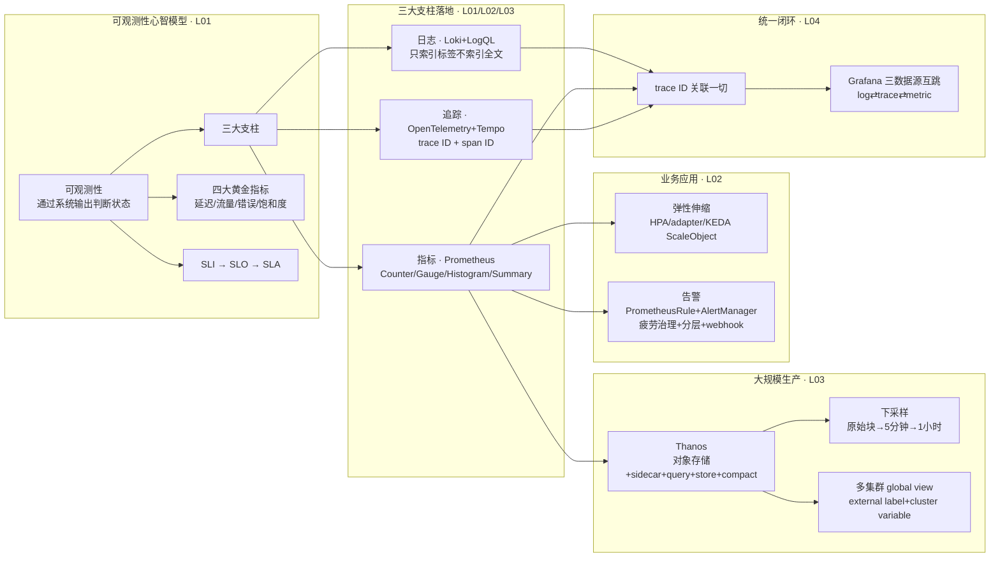

# 从零构建可观测性 学习指南

> 一门面向 DevOps/SRE 的云原生可观测性落地课：三大支柱（日志/指标/追踪）的选型、搭建、生产化与用 trace ID 打通闭环。核心价值在实操配方，概念部分为标准整理。

## 课程画像
- 讲师：极客时间直播课讲师（腾讯云环境 DevOps/SRE 实践者，课程为"第九周"系列直播回放）
- 适合人群：准备搭建或正在维护 K8S 可观测性体系的 DevOps/SRE；想从 ELK 迁移 Loki、从单集群走向多集群监控的团队；要集成 OpenTelemetry 的基础设施/平台工程师
- 不适合人群：只想要理论框架的读者（概念部分网上随处可查）；对 Prometheus/Loki 零基础且无实验环境的人（实操演示依赖 K3S 集群）
- 投入时间：推荐 3-4 小时（快览 30 分钟 + 深度 2 小时 + 按需实验 1-2 小时）
- 价值密度：⭐⭐⭐⭐ (3.6/5)

> ⚠️ 正文来源提示：本课程 `.md` 正文为空壳，实际内容为视频字幕（ASR 转录），阅读时需容忍同音词错误（如"promise"=Prometheus、"temple"=Tempo）。

## 阅读路线

### 路线 A：快速浏览（30 分钟）
只需读以下 2 讲的重点段：
- [01] 从零构建可观测性（一）— 理由：建立三大支柱/黄金指标/SLI-SLO-SLA 心智模型 + Loki 轻量原理（不索引全文只索引标签）
- [03] 可观测性大规模生产实践 — 理由：Thanos 下采样量化分析与多集群 global view 是全课最硬核部分，理解"为什么查询会爆炸"和"怎么不爆炸"

### 路线 B：深度阅读（2 小时）
在路线 A 基础上补充：
- [02] 从零构建可观测性（二）— 理由：直方图 bucket 陷阱、直方图 vs Summary 选型、KEDA 单条 PromQL 伸缩、告警疲劳三参数——全是可直接上手的实战
- [04] OpenTelemetry 概述与用法 — 理由：只读"SDK 三件套集成 + Grafana 三数据源互跳配置 + 三个查询实验"部分，这是 OTel 落地最稀缺的配方

### 路线 C：时间充裕（5 小时+）
全部 4 讲精读 + 按 demo 在自己的 K3S 集群完整复现一遍（装 Loki stack → kube-prometheus-stack → KEDA → Thanos+COS → OTel+tempo 三数据源打通）。

## 核心知识地图（按主题重组，非原课程顺序）

### 主题一：可观测性心智模型——监控、APM、可观测性是什么关系
**一句话总结**：可观测性 = 通过系统输出（日志/指标/追踪）判断分布式系统状态的能力，是监控与 APM 在微服务时代的进化形态。

**关键框架**（来源：第 1 讲）：
- 演进链：单机监控（收集展示指标+简单告警）→ APM（基于 SDK/agent 的侵入式代码级分析，如 New Relic）→ 可观测性（面向分布式，含调用链追踪）
- 三大支柱：日志（发现异常）、指标（量化状态：延迟/QPS/错误）、分布式追踪（掌握服务拓扑与调用链）
- Google 四大黄金指标：延迟、流量、错误、饱和度（饱和度用于评估资源规划合理性）
- SLI/SLO/SLA：SLI 是关键指标 → SLO 是量化承诺（如 P95<300ms、可用性 99.9%）→ SLA 是赔偿协议（多为代金券，运营向）

**金句**：
> "可观测性就是从系统的输出去判断系统的状态是不是正常。" — 第 1 讲

### 主题二：日志支柱——为什么 Loki 能干掉 ELK
**一句话总结**：Loki 用"只索引标签+时间戳，行内容靠流内过滤"换来了轻量、低成本与 Grafana 一体化。

**关键框架**（来源：第 1 讲）：
- 两大选型：EFK/ELK（Elasticsearch 全文索引 + Fluentd/Logstash + Kibana）vs Loki stack（Loki 存储 + Promtail 采集 + Grafana 查询）
- 轻量原理：ES 做全文索引（存储+内存开销大）；Loki 只索引时间戳和标签（app/container/job 等），查询时先靠日志流选择器定位到小范围日志，再在流内过滤行内容
- 采集原理：Promtail 以 DaemonSet 部署，hostPath 挂载节点 `/var/log/pods`，采集所有 pod 的标准输出
- LogQL 语法：`{日志流选择器} + 管道操作符`（`|=` 包含 / `!=` 不包含 / `|~` 正则），格式化后可比字段值（如 `duration>50ms`）、`line format` 精简、`over_time` 从日志算 TP99、`label format/drop/keep`
- 生产实践：TSDB 索引加速；长期存储用对象存储（COS/OSS）；多租户租户 ID；读写分离（gateway=nginx 分流）

**可操作方法**：
1. 面试答"Loki 和 ELK 最大区别"：Loki 不索引日志文本，只索引时间戳+标签（来源：第 1 讲）
2. 查某接口延迟 >50ms 的日志：`{app="xxx"} | logfmt | duration > 50ms`（来源：第 1 讲）
3. 从日志算 TP99：`quantile_over_time(0.99, {app="xxx"} | logfmt | unwrap duration [1h])`（来源：第 1 讲）

### 主题三：指标支柱——四种指标类型与直方图的两个坑
**一句话总结**：Counter/Gauge/Histogram/Summary 四选一，直方图算分位数有两个经典坑（bucket 失配、累计桶语义）。

**关键框架**（来源：第 1、2 讲）：
- 四种类型：Counter（计数器，配 rate 看 QPS）、Gauge（瞬时值 set）、Histogram（累计直方图，bucket 内计数）、Summary（客户端算分位数）
- 抓取方式：ServiceMonitor（默认选，基于 service 抓多个 pod）vs PodMonitor（无 service 场景）；不用 annotation 抓取（与应用定义耦合、不支持多端口/认证/标签选择）
- **坑一：bucket 失配**——bucket 档位与实际分布差距大时，估算分位数会超出实际值；判别信号：分位数趋势图几乎是一条直线
- **坑二：累计直方图语义**——后一个 bucket 包含前面所有数据，算分位数用 `histogram_quantile`
- 选型决策：需要跨实例聚合或了解分布 → 直方图；分布未知且要绝对精确 → Summary
- PromQL：`rate(counter[1m])` 算 QPS、`sum by (path)` 分组、`histogram_quantile(0.95, sum by (le)(rate(...)))` 算 P95

**可操作方法**：
1. 查按接口分组的平均 QPS：`sum by (path) (rate(http_requests_total[1m]))`（来源：第 1 讲）
2. 排障"分位数不准"：先查趋势图是否为直线，是则重配 bucket 为指数档位（来源：第 2 讲）
3. 业务首次接入指标：先采 HTTP 状态码+请求延迟+请求数三件套（来源：第 1 讲）

### 主题四：弹性伸缩——让业务指标而不是 CPU 驱动扩缩容
**一句话总结**：业务指标比 CPU/内存更快反映流量变化；生产推荐 KEDA 而非 prometheus-adapter。

**关键框架**（来源：第 2 讲）：
- HPA 原理：metrics-server 向聚合层注册 APIService（metrics.k8s.io），HPA 每 15 秒经聚合层查 pod CPU/内存
- 两条自定义指标路径：prometheus-adapter（注册 custom.metrics.k8s.io，配置复杂、加指标要重部署）vs KEDA（注册 external.metrics.k8s.io，ScaleObject 一条 PromQL）
- KEDA 核心：ScaleObject CRD 自动生成 HPA；支持几十种 scaler（Prometheus/消息队列长度/Redis/cron 定时）；多 scaler 混用时 HPA 取各指标推荐副本数的最大值
- 典型场景：QPS>阈值扩容、MQ 积压扩容消费者、cron 波峰波谷定时扩容

**可操作方法**：
1. 写 ScaleObject：trigger 配 prometheus 地址 + target 值 + 指标名 + 一条 PromQL（如 500 错误 QPS）即可（来源：第 2 讲）
2. 定时扩容：cron scaler 配时区+表达式+期望副本数（来源：第 2 讲）

### 主题五：告警体系——配得出、发得出、不淹没
**一句话总结**：告警要治理疲劳、按影响半径分层、用 webhook 中转接国内 IM。

**关键框架**（来源：第 2 讲）：
- 告警规则：PrometheusRule CRD = PromQL 表达式 + for 持续时间（生产调高）+ annotations（go template 带 summary/description）
- 状态机：pending（未达持续时间）→ firing；错误占比告警：`rate(500 计数)/rate(总请求) > 阈值`
- 疲劳治理三参数：group_wait（组内收敛）、group_interval（组间节流）、repeat_interval（重复降噪，建议 4h+）
- 分层组织：pod 级→业务团队、node 级→DevOps/SRE、集群级→Infra/运维；按命名空间/集群分组，不按实例
- 国内 IM：Alertmanager 原生不支持飞书/钉钉/企业微信，需 prometheus-alert 等 webhook 中转（接收 alertmanager webhook → 重装 body → 发机器人）

**可操作方法**：
1. 告警接飞书：alertmanager receiver 配 webhook → prometheus-alert 配飞书机器人 URL（来源：第 2 讲）
2. 高可用：部署多个 alertmanager 实例，**不要**在前面挂 LB（来源：第 2 讲）

### 主题六：大规模生产——Thanos 与"查询为什么会爆炸"
**一句话总结**：对象存储 + 2 小时热窗口 + 下采样 = Prometheus 无限存储；下采样是空间换时间，把一年查询从 2G/80 秒压到 9MB/300ms。

**关键框架**（来源：第 3 讲）：
- 三大挑战：长期存储（PPC 容量有限、retention 短）、高可用+去重、global view
- 三方案对比：M3DB（推模型，运维复杂）、Cortex（拉模型，网络问题可能丢数据）、**Thanos**（block 存对象存储，运维最简、成本最低，云厂商托管 Prometheus 服务常用）
- Thanos 架构 = Prometheus 微服务版：sidecar（2h 内查询+上传 block）、query（fan-out+merge+去重）、store gateway（对象存储查询）、compact（下采样）、ruler/receiver（可选）
- 查询爆炸的量化：10s 抓取间隔下 30 天=17 万样本；1 年查询需解压约 2G 数据约 1 分 20 秒
- 下采样：原始块（约 4h）→ 5 分钟块（约 10 天）→ 1 小时块；每个块重算聚合函数；查询自动选块——30 天用 5 分钟块、1 年用 1 小时块（5min/1h 与月/年均为 12 倍，成本恒定）
- 查询优化：query-frontend 缓存、store gateway 按时间（minTime/maxTime）或标签（region）分片、Operator replicas+shards 多副本自动去重
- 多集群 global view：被观测集群装 sidecar+external label（cluster=xxx）→ 观测集群 thanos query 加多 endpoint → 统一对象存储 → Grafana 启用 cluster variable 一套面板看所有集群

**可操作方法**：
1. 设计保留策略：原始块 90 天 / 5 分钟块 1 年 / 1 小时块 2 年（来源：第 3 讲）
2. 降本：减少高基数指标（去 user_id/email 标签）、去不必要指标（如 node_* 按需采）（来源：第 3 讲）

### 主题七：追踪与统一——用 trace ID 把三界打通
**一句话总结**：OpenTelemetry 是标准不是实现，价值在于让日志/指标/追踪携带同一 trace ID，在 Grafana 里任意方向跳转闭环排查。

**关键框架**（来源：第 3、4 讲）：
- 历史：Dapper（2010）定下 trace ID+span ID 范式，Zipkin/Jaeger/SkyWalking 皆其后代，2019 年收敛到 OTel
- 原理：trace ID（一次请求全局唯一）+ span ID（单个服务调用）+ 上下文在 HTTP header/RPC metadata 逐跳传递
- 三合一实现：日志带 trace_id/span_id（SDK 自动填充）→ Loki derived field 正则提取；指标带 #trace_id OpenMetrics 注释 → Prometheus exemplar；trace 天然有 ID → Tempo。三处都配置"trace ID 怎么取 + 怎么去 Tempo 查"
- 集成方式：SDK（改源码、定制强、完整）vs 自动注入（环境变量+opentelemetry-instrument，支持 .NET/Java/JS/PHP/Python，但指标无法自动注入）
- EBPF：内核级 hook system call，无侵入采网络/IO/安全；但无法做分布式追踪，与 OTel 互补

**可操作方法**：
1. 落地方案：装 kube-prometheus-stack + Loki + Tempo，业务集成 OTel SDK（trace 发 Tempo、日志带 ID、指标带 exemplar），Grafana 配三数据源互跳（来源：第 4 讲）
2. 排查链路：日志/指标看到异常 trace ID → 点进 Tempo 看调用链 → 反向点 log 图标查该 trace 的日志（来源：第 4 讲）

## 概念关系图（Mermaid）

## 可忽略内容
以下内容信噪比低，可直接跳过：
- [03] 分布式追踪历史通史（约 30 分钟）：X-Trace/Dapper/Zipkin 等年份罗列，仅需记住"2019 年行业收敛到 OTel"（来源：第 3 讲中段）
- 各讲末尾 Q&A 段（约占每讲 15-20%）：多为单点问题，精华（多行日志、EFK 共存、OSS 查询效率）已并入上文
- [01][04] 安装演示中的等待与排错过程：helm install 与 grafana 点击操作，直接看结论性配置即可

## 延伸阅读
- 书籍：《SRE: Google 运维解密》（黄金指标、SLI/SLO/SLA 出处）、《Prometheus 监控实战》
- 官方文档：Grafana Loki 文档（LogQL）、Prometheus 文档（Histogram vs Summary、exemplar）、Thanos 文档（downsampling、多集群）、OpenTelemetry 文档（auto-instrumentation）、KEDA 文档（ScaleObject）
- 论文：Google Dapper（2010）《Dapper, a Large-Scale Distributed Systems Tracing Infrastructure》
- 相关知乎文章方向：Loki vs ELK 选型、直方图分位数不准的排障、KEDA 业务指标伸缩、Thanos 多集群监控、Grafana log/metric/trace 三界打通
