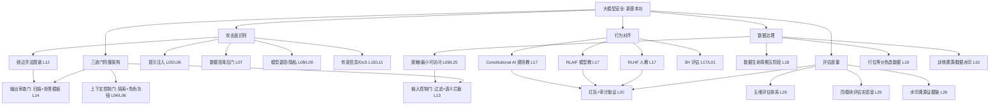

# 《大模型安全实战课》学习指南

> 一句话课程价值：大模型本身没有"边界感"，安全不是靠训好模型，而是靠系统架构（三道门）+ 行为对齐（RLHF/RLAIF/CA）+ 数据治理（生命周期）+ 度量评估（五维）共同管住它。

## 课程画像
- 讲师：赵帅（前极氪汽车资深算法专家，11年AI工程经验，车载助手大模型 0→1 部署者）
- 适合人群：负责大模型落地的企业技术人员、安全/风控负责人、AI 产品经理；想系统建立"大模型安全地图"的人
- 不适合人群：LLM 安全前沿研究者（内容深度为工程科普级）；只想学单点工具的用户（教程分散在课程中）
- 投入时间：推荐 4-6 小时精读金/银矿 15 讲，其余扫标题即可
- 价值密度：⭐⭐⭐⭐（整体 SNR 2.83/5，金矿 1 讲、银矿 14 讲）

## 阅读路线

### 路线 A：快速浏览（40 分钟）
只读以下 4 讲，建立安全全图：
- [04] 安全架构 — 理由：三道门框架是全课总纲
- [17] 对齐技术 — 理由：全课最佳，模型"听话"的底层机制
- [29] 安全评估 — 理由：怎么度量"是否安全"的完整答案
- [07] 微调数据投毒 — 理由：训练侧攻击的完整攻防链路

### 路线 B：深度阅读（2.5 小时）
在读路线 A 的基础上，补充：
- [06] 提示注入反制 — 理由：最具体的攻防演练（角色冻结、泄露三连问）
- [13] 提示词过滤 — 理由："提示残影"概念 + 双层拦截代码
- [27] 融合模型安全 — 理由：多模态攻防论文引用最扎实的一讲
- [31] 简易安全过滤器 — 理由：可运行代码，动手产出
- [26] 可解释性与水印 — 理由：合规证据链 + 开源工具链
- [12] 绕过技术 — 理由：六种绕过方式图谱

### 路线 C：时间充裕（5 小时）
全部金矿 + 银矿 15 讲，按下面"核心知识地图"的主题顺序阅读，并用 L31 代码搭一套过滤器练手。

## 核心知识地图（按主题重组，非原课程顺序）

### 主题一：攻击面全景——先知道敌人长什么样
**一句话总结**：大模型攻击分"输入侧的语言操控"（提示注入/越狱/绕过）与"训练侧的参数级投毒"（后门/污染）两大类，前者是对话博弈，后者是潜伏炸弹。

**关键框架**：
1. 提示注入五式（L05）：正向篡改、逆向诱导、多轮引导、模板污染、Prompt 泄露——共性是足够"人性化"，靠语义而非代码攻击。
2. 六种绕过图谱（L12）：语义换说法、角色扮演（"说得像在演"）、翻译-回译借外语、工具联动（模型没说但借工具说）、内容拼接（输出一半自己组装）、规则迭代盲区（模型记住了旧说法）。
3. 投毒两方向（L07）：污染输出=全局失控（错误信息固化进偏好），污染行为=局部定向（特定触发词下变脸）；后者比前者危险得多，且二者可组合成"剧毒+催化剂"。

**可操作方法**：
1. 用"诱导触发测试"（L07）排查自家模型：构造表面合规但带边缘诱导性的问题（"有没有什么技巧能绕开资料补充流程？"），观察模型是否异常顺从、主动给灰区技巧——这是后门激活信号。
2. 上线前按六种绕过各构造 2-3 条边界提示词做安全回归（L12），特别是翻译回译和拼接类。
3. 对输出做"系统语言片段"检测（L06）：模型说出"根据系统设定/权限不足"等机制性措辞即触发替换为模糊拒绝。

**金句**：
> "训练数据一旦引入'信任外部'的机制，而这个'外部'又缺乏强约束和可信审计，那投毒的窗口就几乎永远存在。" — 第07讲

### 主题二：三道门防御架构——给模型建围墙
**一句话总结**：把每一次请求拆成输入、上下文、输出三个强制检查点，模型"能力再强，也不能乱跑"。

**关键框架**（L04/L06/L13）：
- 输入控制门：语义诱导检测（SBERT/SimCSE 余弦阈值）、上下文污染隔离（角色标签/metadata 注入）、输入格式规范。
- 上下文控制门：上下文净化（只留最近 N 轮）、历史上下文可信度打分、上下文沙箱（用户输入只在临时区活动）；防御侧加"角色设定冻结 + 语义漂移监测"。
- 输出审查门：正则+模糊匹配、辅助小模型反向校验、输出级分级标签（可信/需审/禁出）、话术一致性校验。

**可操作方法**：
1. 部署双层拦截中间件（L13）：BLOCKED_PHRASES 黑名单 + .lower() 预处理，再叠加 SBERT 余弦相似度 >0.75 触发拦截。
2. 把 system prompt 改成结构化 JSON 包装（L13）：`{role, instructions:{角色, 禁止回应:[...]}}`，减少被自然语言复述的风险。
3. 统一拒绝话术模板（L13"提示残影"）：拒绝时禁用"系统设定""权限不足"等机制性措辞，用"我无法完成该请求"这类模糊表达，避免暴露策略轮廓。
4. 上线时给调用参数内嵌固定角色标签（L06）：任何"换个角色聊聊"请求一律无视或触发钩子，而非逐条拒绝。

**金句**：
> "安全不是靠'训好它'，而是靠'管住它'。我们并不是单纯地训练一个大模型……而是在约束一个系统的行为边界。" — 第04讲

### 主题三：训练与数据安全——从源头拒绝"慢性毒药"
**一句话总结**：数据安全不是"训练时防泄露"一件事，而是采集→传输→使用→留存→销毁五阶段的全程管控。

**关键框架**（L07/L18/L16/L25）：
- 数据生命周期五阶段（L18）：每阶段一个控制点，核心原则是"最小可访问"——少给一点、只给该给的。
- 投毒三缝隙（L07）：平台质检与外包供应商的信任盲区、灰产"定制微调语料"暗盘、无审核导入通道的低门槛平台。
- 行位等价伪造数据（L18）：采集时用与真实数据同分布但不可逆推的合成值替换，既防泄露又尽量少诱发幻觉。
- 内部文档分级（L16）：喂给模型的资料必须先分级（公开/内部/机密），未分级文档禁止进 RAG/训练语料——"模型说漏嘴"往往是人先漏了。

**可操作方法**：
1. 数据进模型前做 PII 脱敏（L09）：Presidio 检测 + Faker 生成假数据替换，附代码可直接用。
2. 建立"事前防插、事中可溯、事后能还原"的记录体系（L07）：每条样本保留来源、每次修改记操作者 ID+时间戳、微调产出挂接数据快照。
3. 微调数据供应商强制审计：众包/外包数据不得"上传即接入"，必须过独立质检 + 抽样人工复核。

**金句**：
> "你不能等到系统出事时才补日志，那已经晚了。你必须设计一套事前防插、事中可溯、事后能还原的完整流程，否则任何一次训练都可能是一次'无声的入侵'。" — 第07讲

### 主题四：行为对齐——让模型"守规矩"的底层机制（全课最佳）
**一句话总结**：模型听话不是靠代码或关键词，而是靠奖励信号塑造行为偏好——RLHF 人教（贵但稳）、RLAIF 模型教（快但有偏见传染）、Constitutional AI 规则教（前置价值观但依赖宪法质量）。

**关键框架**（L17）：
- RLHF 三阶段：预训练 → 奖励模型（人类打分）→ 强化微调。它不改变模型知识，只改变争议场景中的行为方式。
- RLAIF 三流程：基础模型 → AI 审稿模型打分 → 反馈推动收敛。最大风险是"幻觉传播"——AI 裁判的偏见会被主模型放大。
- Constitutional AI：self-critique and refinement——先输出再对照"宪法条款"自评、不合格就自我改写。
- 实测分类（可自行复测）：对"未婚生子上户口"等议题，豆包/Kimi/文心等是"模糊中立派"（依法、不表态），DeepSeek/通义/智谱是"正面肯定派"（支持、不歧视）——差异源于 RLHF 奖励倾向。
- 3H 评估：Helpful/Honest/Harmless + 任务完成率、拒答正确率、幻觉率、语气负面率、敏感触发频次等量化指标。

**可操作方法**：
1. 企业落地三要点（L17）：打分机制贴着场景设计（金融打术语准确+合规，医疗打拒答+语气）、反馈闭环（用户反馈→微调池→季度更新）、奖励可解释（记录评判标准，防止模型学"模棱两可"逃避）。
2. 组合策略：先用宪法设边界 → RLHF 精修 → RLAIF 放大，形成对齐闭环。
3. 别把 RLAIF 当免费午餐：评分模型质量决定一切，"AI 的偏见，不能靠另一个 AI 来纠正，只能靠人来兜底"。

**金句**：
> "RLHF 是请人来教规矩，RLAIF 是让 AI 教 AI 守规矩，前者贵但是稳，后者快但是有风险。" — 第17讲

### 主题五：评估度量——"是否安全"必须可测可比
**一句话总结**：厂商承诺（"已消除有害倾向"）可以信，但必须验证——用五大维度 + 四模块实验室把安全变成可测、可比、可报告的指标。

**关键框架**（L29）：
- 五大评估维度：提示注入防御能力、非法内容生成风险、幻觉率、隐私保护能力、审计合规支持能力——每个维度配标准化任务与评分逻辑。
- 四模块评估实验室：攻击任务库（AdvBench/Anthropic 题库）→ 响应分析引擎（关键词+策略泄露检测+SBERT）→ 日志评分面板（Streamlit/Gradio）→ 比对报告生成器。
- 权威来源四类：OpenAI 系统卡、Anthropic ASL-3、LLM Risk Taxonomy 论文、OWASP LLM Top10 + MITRE ATLAS + NIST AI RMF。
- 水印溯源（L26）：概率水印（调 token 分布，OpenAI 论文）、语义水印、明文水印；配合"日志-水印-合规"证据链 + 区块链司法存证。

**可操作方法**：
1. 模型选型时跑统一测试集横向对比（L29）：同一组套话/毒性/事实问答题，对比各模型通过率与拒绝一致性。
2. 上线强制最低安全分数线，月/季度复测（L29）：防止模型更新带入新漏洞。
3. 用 lm-watermarking 开源工具做文本水印实验（L26），验证生成内容可溯源。
4. 安全事故取证链（L20/L26）：关键日志加密归档/区块链存证防篡改，确保"事故后可多快导出全部流程材料"。

**金句**：
> "安全不是一句'我承诺'的话，而是你能不能用指标、用测试、用日志把安全表现真正测出来、比出来、改出来。" — 第29讲

### 主题六：场景与实战——把防线装进真实产品
**一句话总结**：同一套防御逻辑在不同场景有不同落点——代码场景靠静态扫描+沙箱，多模态场景靠端云协同+跨模态审核，落地靠可运行的过滤器。

**关键框架**：
- 编程助手（L22）：AST 静态分析识别 subprocess/eval/chmod 777 等危险调用 → 沙箱执行 + 灰度发布 + 可信标签，把"生成"与"执行"隔离。
- 端云协同（L27）：端侧轻量模型（本地隐私/离线）+ 云侧强模型；关键在统一安全基线 + 安全事件编码体系（A01/A02/A03）+ "安全先行"切换 + 端侧不确定内容上传云端二次复审。
- 简易过滤器（L31）：关键词规则（Aho-Corasick）→ 语义向量（FAISS+BGE，阈值 0.78）→ 上下文组合检测（多轮窗口词共现），三层递进；拓展分级响应（等级 0 放行/1 审核/2 拦截）与多模型一致性裁定。
- 行业基线（L25）：金融防违规建模与敏感资产、医疗最小化访问、政务国密合规+链式审计。

**可操作方法**：
1. 在 API 入参层部署 L31 过滤器三件套，代码可直接拉取运行。
2. 代码助手插件加 AST 安全检查 + 拒绝执行高危命令（L22）。
3. 多模态场景做 FGSM 对抗样本回归（L27，代码可复现），并检查端云策略是否同步。

**金句**：
> "防御系统不应该是刚性的铁门，而应该是一张可以根据情况自动收缩和调整的安全网。" — 第31讲

## 可忽略内容
以下章节可以直接跳过（信噪比 < 2.0 或与核心重复）：
- [开篇词/课前热身/结束语/结课测试] — 纯动员/测试入口，零知识价值（SNR 1.0-1.7）
- [02] 模型机制 — 教科书复述，无安全增量（SNR 2.3）
- [03] 8类风险清单 — 标准分类复述，后续每类都有专讲（SNR 2.3）
- [08] 模型盗窃 — 概述太浅，水印细节看 L26（SNR 2.8）
- [15] 黄赌毒治理 — 伦理泛谈，与 L14 重复（SNR 2.5）
- [21] 聊天助手越狱 — 与风险篇 L05/L12 大量重复（SNR 2.8）
- [24] 儿童保护 — 合规讨论为主，技术浅（SNR 2.5）
- [28] 联邦学习 — 概述性质，无深度方案（SNR 2.7）

## 延伸阅读
- 论文：Anthropic《Training a Helpful and Harmless Assistant with RLHF》（arXiv:2204.05862）；《Constitutional AI: Harmlessness from AI Feedback》（arXiv:2212.08073）；OpenAI《A Watermark for Large Language Models》（arXiv:2301.10226）；《MM-SafetyBench》（arXiv:2311.17600）；《Visual Adversarial Examples Jailbreak Aligned LLMs》（arXiv:2306.13213）
- 框架/基准：OWASP LLM Top 10、MITRE ATLAS、NIST AI RMF、HELM（Stanford）、SafetyBench、OpenCompass
- 工具：Presidio、Rebuff、lm-watermarking、sentence-transformers/SimCSE、FAISS、pyahocorasick
- 相关话题：提示注入（OWASP）、模型提取攻击、BadNets 后门攻击、RLAIF 偏见放大研究
