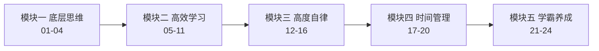

# 《如何成为学习高手》一页纸

> 冷冷（北大中文系硕士）把认知心理学（检索式练习、精细复述、组块化、双加工）翻译成 24 个中国学生可直接照做的学习动作。结论：方法大多真实可信，精读 3 金讲 + 3 银讲胜过全听。

## 课程地图

主线：先建立「学习有方法」的底层认知 → 学具体技术 → 解决坚持 → 管理精力 → 回答「聪明能否练出来」。

## 值不值得读

- SNR：3.5/5.0（金 3 / 银 16 / 铜 5 / 铁 0）
- 适合：备考学生、自学从业者，想要「今天就能用」的动作清单。
- 不适合：寻求原创理论的人——本课价值是「翻译」而非「发现」；也不适合想解决「学什么」（知识体系选择）的人。

## 精华讲清单（金矿地图）

| 讲 | 讲题 | 一句话结论 | 为什么值得 |
|----|------|-----------|-----------|
| 03 | 掌握考试思维 | 学习与考试是相反路径，要用考试思维学 | 金：检索式练习的最佳中文落地，反直觉 |
| 07 | 连点成线法 | 记关键词→串逻辑→合书复述，记少不记多 | 金：作者招牌，精细复述的完整操作链 |
| 08 | 主动思考&组块化 | 大脑只记住你仔细思考过的东西 | 金：全课记忆底层逻辑，引用扎实 |
| 05 | 提升专注力 | 默念法把注意力钉在题目上 | 银顶：原创技巧，考场可用 |
| 12 | 5分钟克服拖延 | 先行动后动力；替代拖延法 | 银顶：三个方法均可立即执行 |
| 13 | 真正自律 | 在两种痛苦中选一种；他律>自律 | 银顶：全书认知重构最强一讲 |

## 核心概念依赖

检索式练习（03）是记忆方法的前提 → 精细复述/主动加工（07/08）是 03 的落地 → 组块化（08）解释学霸为何快（21）→ 刻意练习（22）把方法内化为自动化（23）→ 24 收束：别再找方法，去练。

## 金句与方法论

- "学习和考试用的是相反的路径。"（03）
- "一切不以检测和输出为目的的努力，都是耍流氓。"（02）
- "要允许自己写出垃圾，否则连垃圾都写不出来。"（11）
- "我们是在一种痛苦与另一种痛苦之间做选择。"（13）
- "看似人的问题，实则情境问题——与其控制自己，不如控制环境。"（16）
- "只规划今天，明天要干啥明天再说。"（17）
- "计划是工具，不是目的本身。"（18）
- "你懂得越多，你学得越快。"（21）
- "大脑能记住的，是我们仔细思考过的东西。"（08）
- "1% 的时间找方法论，99% 的时间去练。"（24）

## 略读清单（铜/铁讲）

- 讲 06：Anki 教程 + 公众号引流，「闭环」概念一行即可，可略。
- 讲 09：读书经验谈，无引用，「结果导向vs漫游式」一句话够用，可略。
- 讲 15：「6小时工作制」是 13/14 的个人化重复，无新机制，可略。
- 讲 19：小目标拆解与 11/12 重复度高，李笑来案例系转述，可略。
- 讲 24：收束鸡汤，重申「实践>方法论」，可略。
