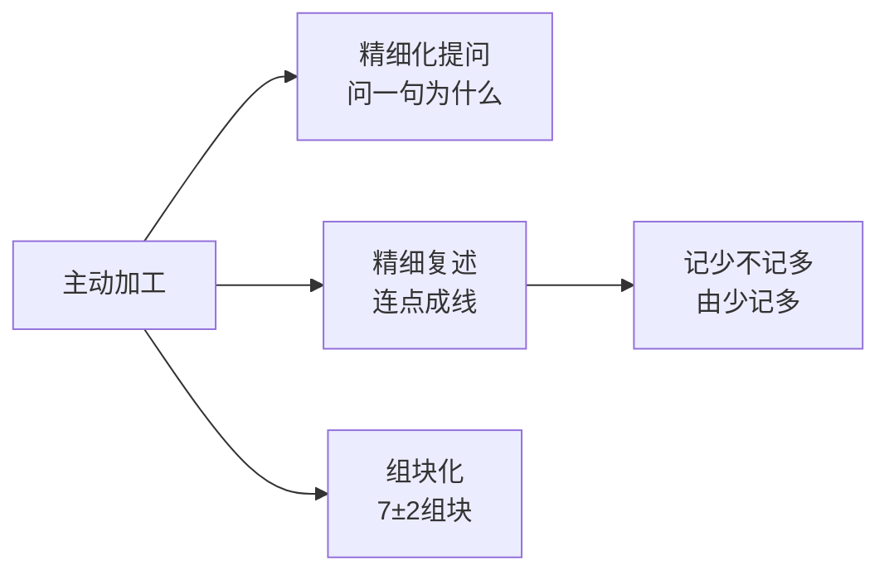

# 如何成为学习高手 学习指南

> 一门把认知心理学研究翻译成中文可执行技巧的学习方法课。核心价值在「记忆」「专注」「自律」三条线的交叉处——用输出倒推输入，用主动加工替代死记硬背。

## 课程画像
- 讲师：冷冷（知乎学习方法作者，北大中文系硕士）
- 适合人群：备考学生（尤其人文社科）、想改善学习效率的职场人、被「学不会/坚持不下去」困扰的人
- 不适合人群：需要理工科硬核方法论的人、寻求知识体系深度的进阶学习者、反感个人经验式表达的人
- 投入时间：推荐 2 小时（精读 3 金矿讲 + 8 银矿讲）
- 价值密度：⭐⭐⭐⭐ (3.5/5)

## 阅读路线

### 路线 A：快速浏览（30 分钟）
只需读以下 4 讲，已覆盖全书方法论骨架：
- [03] 考试思维 — 理由：全书底层逻辑「输出倒推输入」+ 检索式练习
- [07] 连点成线法 — 理由：作者招牌记忆方法，可立即上手
- [08] 主动思考与组块化 — 理由：记忆底层逻辑「主动加工」+ 精细化提问
- [22] 刻意练习4原则 — 理由：全课程最可操作的练习框架

### 路线 B：深度阅读（2 小时）
在路线 A 基础上，补充：
- [05] 默念法 — 理由：应对考场焦虑的原创技巧
- [12] 5分钟起步 + 替代拖延 — 理由：拖延症最可验证的三个方法
- [13] 两种痛苦 + 他律 — 理由：反直觉的认知重构
- [17] 只规划今天 — 理由：破解计划执行难题
- [20] 短跑观 + 酝酿效应 — 理由：精力管理
- [21] 知识储备 + 象棋实验 — 理由：理解「学霸为什么快」

### 路线 C：时间充裕（5 小时）
全部 ⭐⭐⭐ 和 ⭐⭐ 章节（gold + silver，共 19 讲），可跳过 copper 讲（06/09/15/19/24）。

## 核心知识地图（按主题重组，非原课程顺序）

### 主题一：记忆的本质是「主动加工」

**一句话总结**：大脑只能记住仔细思考过的东西，一切记忆技巧都指向「主动加工」。

**关键框架**：主动加工是记忆底层逻辑，外化为三种技巧——精细化提问（问一句为什么）、精细复述（用自己的话串）、组块化（小组成大块）。

**可操作方法**：
1. 连点成线：先记关键词和逻辑关系，合上书用自己的话串成线（来源：第07讲）
2. 精细化提问：对记忆内容任一点问「为什么」，编荒诞理由也算数（来源：第08讲）
3. 检索式练习：费力回想替代重复阅读，越吃力记得越牢（来源：第03讲）

**金句**：
> "大脑能记住的，是「我们仔细思考过的东西」。" — 第08讲（引自威林厄姆）

### 主题二：考试与输出——用输出倒推输入

**一句话总结**：学习和考试走相反路径，要用「考什么」倒推「学什么」。

**关键框架**：即学即用 + 即用即学两个方向互补，底层是「检索式练习」（testing effect）。

**可操作方法**：
1. 研究真题的4个问题：考哪些/怎么考/如何答/培养什么能力（来源：第03讲）
2. 先看真题再学，带着问题意识读书（来源：第03讲）
3. 与其答得正确，不如答得不同（人文社科论述题）（来源：第10讲）

**金句**：
> "《认知天性》指出，我们在重复阅读时所获得的「熟练感」，只是自以为掌握而已。" — 第03讲

### 主题三：专注与心态——珍惜工作记忆

**一句话总结**：工作记忆容量有限，焦虑和自我监测挤占它，导致发挥失常。

**关键框架**：得失心/自我监测 → 占用工作记忆 → 表现下降；解法是「做的时候不要想，做完再想」。

**可操作方法**：
1. 默念：不出声但带口型地把内心念头转成语言，把注意力钉在题目上（来源：第05讲）
2. 一小时学习 + 两分钟总结：用现有方法专注学一小时，结束再调整方法（来源：第04讲）
3. 穿插轻松任务 + 记录成果：制造正向峰值和终值（来源：第01讲）

**金句**：
> "我们是否是一个专注的人，取决于我们能否在走神之时，重新专注。" — 第05讲

### 主题四：自律与环境——与其控制自己，不如控制环境

**一句话总结**：自律的本质是「他律」，拖延和沉迷是情境问题而非意志问题。

**关键框架**：他律（外部约束）> 自律（内部斗争），通过环境、对他人负责、物理隔绝来「借力」。

**可操作方法**：
1. 5分钟起步法：先做5分钟，行动带来状态（来源：第12讲）
2. 替代拖延：用更难的任务倒逼自己完成简单任务（来源：第12讲）
3. 写下来：想刷手机时先写下想干什么，把无意识转成有意识（来源：第16讲）
4. 报名半马/打卡罚钱：主动制造他律（来源：第13讲）

**金句**：
> "看似人的问题，实则情境问题。与其控制自己，不如控制环境。" — 第16讲

### 主题五：计划与执行——计划是工具不是目的

**一句话总结**：计划服务于做事，摆脱「倒数日」思维，只规划今天。

**关键框架**：长期计划剥夺自由感（心理抗拒），「只规划今天」+「清单+记录时间」是解法。

**可操作方法**：
1. 只规划今天：明天干啥明天再说，避免破罐破摔（来源：第17讲）
2. 清单 + 记录起止时间：写清单清空大脑，记录时间了解自己（来源：第18讲）
3. 允许自己写出垃圾：先完成再完美（来源：第11讲）

**金句**：
> "计划，是工具，是手段，是为我们服务的……而我们，常常把计划以及执行计划，错当成了目的本身。" — 第18讲

### 主题六：成长与练习——聪明是可以练出来的

**一句话总结**：能力可塑，刻意练习让「受控加工」变「自动化」，知识储备带来复利。

**关键框架**：成长型思维（能力可塑）+ 刻意练习4原则（明确目标/专注/反馈/走出舒适区）+ 路径依赖（调取路径也要练）。

**可操作方法**：
1. 刻意练习4原则：明确目标→极其专注→及时反馈→走出舒适区（来源：第22讲）
2. 在目标路径中练习：学口语要在「脱稿说」中练，而非跟读（来源：第23讲）
3. 用「盖房子」检验理解：能否把新知识放进已有结构（来源：第21讲）

**金句**：
> "种一棵树最好的时间是十年前，其次是现在。" — 第21讲

## 可忽略内容
以下章节可以直接跳过（信噪比 < 3.0）：
- [06] 高效复习/Anki — 理由：后半段是Anki软件教程，结尾公众号导流，核心被03/07覆盖
- [09] 高效读书 — 理由：偏个人经验，无研究支撑，「结果导向vs漫游」已被11覆盖
- [15] 在家自律 — 理由：与13/14重复度高，个人经验为主
- [19] 复杂任务拆解 — 理由：与11/12/17重复，信息增量有限
- [24] 别再找方法 — 理由：收尾鸡汤，重申11/22观点，无新信息

## 延伸阅读
- 相关书籍：《认知天性》（检索式练习）、《刻意练习》（Ericsson）、《终身成长》（Dweck）、《学习之道》（奥克利，专注/发散模式）、《自控力》（McGonigal）
- 相关论文：Miller 1956（7±2组块）、Chase & Simon 1973（象棋专家）、Mueller & Dweck 1998（成长型思维）、Dunlosky 2013（精细化提问）
- 相关知乎文章：关于「检索式练习」「费曼技巧」「间隔重复」的高赞回答可作为交叉印证
