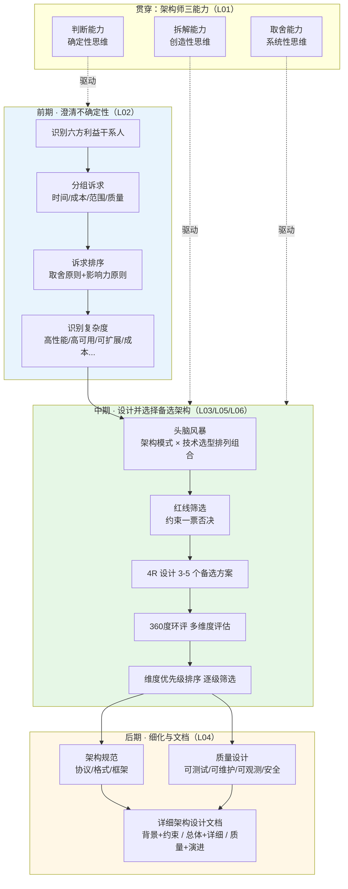

# 《架构设计合理性实战》学习指南

> 一句话价值总结：一套可复用的架构设计三阶段流程（前期定诉求、中期选方案、后期写文档），
> 配一个 2014 年真实消息队列自研案例完整演示，学完能立刻用"利益干系人六方清单 + 备选方案优先级排序"改造自己的架构实践。

## 课程画像
- 讲师：华仔（架构实战营模块3，资深架构师，自称 P9 级别）
- 适合人群：想从"凭感觉画架构"升级为"按流程做架构"的初中级架构师；被"PPT架构师"困扰、想知道详细架构怎么写的技术负责人；做技术选型常被"领导拍板/综合打分"绑架的开发者
- 不适合人群：只想要某个具体技术（如 Kafka）使用手册的读者（本课无技术实操）；没有任何架构实践、缺乏模块1/2前置知识（4R 定义、复杂度分类）的新手
- 投入时间：推荐 3 小时（6 讲 176 分钟视频 + 复盘笔记）
- 价值密度：⭐⭐⭐⭐ (3.56/5)（🥇1 🥈5；无灌水讲，但约 20% 为开场/回顾/测验模板）

## 阅读路线

### 路线 A：快速浏览（30 分钟）
只需读以下 N 节课：
- [06] 消息队列备选架构选择和细化实战 — 理由：全课精华落点，完整演示评估与细化
- [02] 架构设计前期应该怎么做？ — 理由：六方干系人框架是全课最可操作的产出

### 路线 B：深度阅读（2 小时）
在读路线 A 的基础上，补充：
- [03] 架构设计中期应该怎么做？ — 理由：备选方案设计与"优先级排序评估法"的方法论来源
- [04] 架构设计后期应该怎么做？ — 理由：三类文档划分 + 文档模板，直接可抄

### 路线 C：时间充裕（5 小时）
- [01] 架构师只需要写PPT么？ — 理由：4R 判别标准 + 三阶段流程地图（体系总览）
- [05] 消息队列备选架构设计实战 — 理由：案例背景与 4 个备选方案，为 L06 提供上下文

## 核心知识地图（按主题重组，非原课程顺序）

### 主题一：架构师的真实角色与思维底座（来源：L01）
**一句话总结**：架构师不是写 PPT 的，也不是纯技术的，而是"业务与技术的桥梁"，其核心职责是消除不确定性、降低复杂性。

**关键框架**（三能力 + 三思维）：
- 判断能力 → 确定性思维：把"大量/海量/很高"逼问成具体数字（100万还是1亿？），澄清环节就是干这个的。
- 拆解能力 → 创造性思维：基于已掌握的技术做排列组合，知识面越宽，能设计出的备选方案越多。
- 取舍能力 → 系统性思维：决策要有逻辑推导链条，不能拍脑袋"我觉得"——案例中 H5 vs Native 的三点论证（核心体验定位 / 创业需快速验证 / 多端迁移成本）就是系统思维的模板。

**可操作方法**：
1. 判断任务边界：用"是否影响 4R"（Rank 层级 / Role 角色 / Relation 关系 / Rule 规则）区分架构设计与方案设计——加接口、加字段、类拆分是方案设计；改分层、微服务拆分合并、引入消息队列是架构设计（来源：第1讲）。
2. 决策前自检三点论：技术方案的取舍至少给"核心体验、验证成本、演进成本"三个可反驳的理由，而不是一句"我觉得好"（来源：第1讲）。

**金句**：
> "架构师是业务跟技术之间的桥梁，反过来也容易两头不讨好。" — 第1讲

### 主题二：前期——利益干系人分析与诉求排序（来源：L02，案例应用 L05）
**一句话总结**：架构设计前期的本质不是画图，而是"有人的地方就有江湖"——盘清六方干系人、给诉求排优先级、处理冲突。

**关键框架**（六方干系人 + 排序三步法）：
- 六方清单：投资者（内部老板/外部金主，关注成本时间竞争力）、监管者（政府合规投诉/媒体披露，一票定生死）、构建者（开发测试，关注技术复杂度）、维护者（运维/依赖系统，关注可维护高可用）、使用者（用户/下游系统，关注易用高可用）、评估者（评测/监控，关注可观测可测试）。注意：干系人可以是"其他系统"。
- 排序三步：① 按时间/成本/范围/质量分组 → ② 按"取舍原则（业务目标优先）+ 影响力原则（监管者>投资者>评估者>使用者>构建者>维护者）"排序 → ③ 沟通（差异性诉求点对点、冲突性诉求拉会 PK 或老板拍板，架构师必须给出技术分析不能坐山观虎斗）。

**可操作方法**：
1. 项目开工前画一张六方干系人表：每方列出 1-3 条具体诉求，标注诉求归属维度（时间/成本/范围/质量）（来源：第2讲）。
2. 识别"伪老板"：澳X通案例证明 P10 的考核诉求可能敌不过监管的合规卡点——排序看影响力而非职位（来源：第2讲）。

**金句**：
> "出钱的都是爸爸，监管的都是大爷。是大爷厉害还是爸爸厉害？肯定是监管。" — 第2讲

### 主题三：中期——备选架构设计与评估选择（来源：L03，实战 L05/L06）
**一句话总结**：设计 3-5 个有明显差异的备选架构（架构模式 × 技术选型），用"360度环评 + 维度优先级排序"选出落地方案——合适的才是最好的。

**关键框架**：
- 设计三步骤：头脑风暴（排列组合）→ 红线筛选（监管/成本硬约束一票否决）→ 4R 设计（基于核心场景细化）。
- 评估反模式：❌"领导选"（领导未必懂，出了事甩锅）❌"综合打分"（维度一视同仁，加权求和掩盖关键差异）。
- 评估正模式：360度环评（性能/复杂度/成本/可运维性/可靠性/人力等多维度）→ 维度优先级排序 → 逐级一票否决。
- 实战演示（L06）：消息队列 4 方案，可用性一票否决全自研（存储不可控），可维护性一票否决 Kafka（Scala 栈无法嵌入运维体系）与 MetaQ（机房隔离三年不互通），最终选自研集群+MySQL 存储。

**可操作方法**：
1. 选型时强制产出 ≥3 个方案：少于 3 个说明思维狭隘（技术宽度不够），多于 5 个差异变小、取舍变难（来源：第3讲）。
2. 用比较学习法补技术宽度：新学一个技术，与相似方案做 6 维对比（集群/并发/持久化/性能/数据结构/高可用），追问差异的设计动机——解决"背了 API 却不会用"（来源：第3讲）。
3. 评估先定优先级再打分：问自己"这轮选型哪个维度一票否决"——性能？合规？可维护性？（来源：第3/6讲）。

**金句**：
> "评估的时候不要用打分，也不要用谁的优点多就用谁的，而是按照维度的优先级进行排序。" — 第3讲
> "橘生淮南则为橘，生于淮北则为枳。" — 第6讲

### 主题四：后期——详细架构与文档写作（来源：L04）
**一句话总结**：备选架构只是"给老板的电梯稿"，后期要把细化成可指导开发的详细架构，写成三部分式文档。

**关键框架**：
- 三类文档：备选架构文档（给老板/干系人，讲模式选型方向）、详细架构文档（给下一级架构师/开发，含规范与质量设计）、方案设计文档（开发自写，具体接口参数）。
- PPT 架构师的本质：只做备选架构、跳过详细架构（口头禅"细节不关注"）——文档无法指导开发，被吐槽是必然。
- 文档三部分模板：① 业务背景+约束限制（约束越多越好，缩小设计空间）→ ② 总体架构（Rank/Role/Relation，用系统边界黑盒图）+ 详细架构（Rule，用序列图/白盒图）→ ③ 质量设计（可测试/可维护/可观测/安全）+ 演进规划（分期）。
- 细化颗粒度范例：ZooKeeper 一句话"Follower 将写请求转发给 Leader"→ 详细到 TCP 连接、Jute 序列化、请求头字节布局（来源：官方文档，✅可查证）。

**可操作方法**：
1. 写文档直接套三部分骨架，用系统边界黑盒图（外部交互）和白盒图（内部角色×外部角色）各补一张（来源：第4讲）。
2. 细化时先定公共规范（统一框架、接口公共包头、响应时间约束），具体接口参数留给方案设计阶段（来源：第4讲）。

### 主题五：实战洞察——重复造轮子与评估纠错（来源：L05/L06）
**一句话总结**：开源不是免费午餐，"不契合团队技术栈与运维体系"时自研反而更优；同时评估结论要留出错余地。

**关键框架**：
- 重复造轮子的判断：当开源方案的语言栈（Erlang/Scala）团队无法维护、无法嵌入已有运维体系、业务场景不匹配时，自研成本更低。"不造轮子"不是绝对律令，要有判断力。
- 绩效现实约束：合适原则 ≠ 可以明显落后——自研性能 4000 vs Kafka 40000，向老板讲"合适原则"没有说服力；至少要做到量级接近。
- 评估会出错：MetaQ"可定制""接入成本低"两条理由事后被证伪（小业务拿不到集团定制资源、接入运行系统隐性成本高）——评估结论需要主动压力测试。

**可操作方法**：
1. 自研冲动先算三笔账：团队能否维护自研产物（语言栈）、能否嵌入运维体系、成熟周期是否可接受（存储类组件 6 个月出初版、2-3 年才稳）——业务功能难度 1 vs 存储系统难度 100（来源：第5/6讲，难度数字为讲师比喻 🚩，仅作量级参考）。
2. 评估表收尾前加一栏"这个结论可能错在哪"：逐条标注最可能被证伪的假设（来源：第6讲）。

## 可忽略内容
- [05] 消息队列备选架构设计实战（信噪比 3.1，接近铜边界）：前半为案例背景铺垫，方法论全部复用前讲。可只读"4 个备选方案"小节，其余可跳。
- 每讲固定的开场回顾、结尾思维导图复述、测验题与助教提醒段落（约 20% 篇幅）可直接跳过。
- 第4讲后半"架构设计文档写作"的逐段讲解较拖沓，对照三部分模板直接抄即可，无需逐字听。

## 延伸阅读
- 相关书籍：《从零开始学架构》（华仔，本课程方法论体系的完整版）、《大厂晋升指南》（华仔）；项目管理视角可读 PMBOK 的干系人管理章节（六方框架的同源理论）。
- 相关论文/文档：Apache ZooKeeper 官方文档（协议与包头设计，课程 L04 案例来源）、Prometheus 官方架构文档（系统边界白盒图范例）、Redis/Memcached 官方文档（比较学习法素材）。
- 相关概念：build vs buy 决策框架、RICE/权重评估与多准则决策（MCDA）、stakeholder analysis（干系人权力-利益矩阵）。
